## 为什么长视频需要记忆

**本章目标**

- 用数量级估算理解长视频的计算瓶颈；
- 区分“视频很长”和“记忆很难”；
- 理解长上下文为什么是强基线，却不自动等于长期记忆；
- 为一个任务写出工作负载、证据结构和预算假设。

### 先做一个数量级估算

设视频长度为 $T$ 秒，采样率为 $f$ 帧/秒，每帧经过视觉编码器后产生 $P$ 个 Token，问题和提示占 $L_q$ 个 Token，则多模态序列长度近似为
$$
L = TfP + L_q.
$$

两小时视频若按 1 FPS 采样、每帧保留 256 个视觉 Token，仅视觉部分就有 $7200\times256\approx184$ 万 Token。标准自注意力在一次前向中的两两交互量随 $L^2$ 增长[1](#ref-1)。即使采用低帧率，解码、视觉编码、上下文预填充和 KV Cache 也分别消耗时间与显存。

视频骨干如 TimeSformer、ViViT 和 Video Swin 通过分解时空注意力或局部窗口降低短片段成本[2](#ref-2), [3](#ref-3), [4](#ref-4)；Longformer、Perceiver、S4 和 Mamba 则从稀疏注意、潜在数组或状态空间递推扩展序列长度[5](#ref-5), [6](#ref-6), [7](#ref-7), [8](#ref-8)。它们改变了“怎样处理长序列”，却没有替我们决定“哪些事件值得长期保存”。

**贯穿案例：预算账本**

长时会议系统每秒解码1帧，但只允许重型视觉编码器处理其中的五分之一；稳态记忆上限为 4096 个向量，每个问题最多回看 12 个片段，P95 响应时间低于 4 秒。这样的约束比“支持两小时视频”更能确定系统设计。

### 长度不是唯一难度

一个小时的固定机位讲座，问题可能只依赖某一张投影片；一分钟实验视频，也可能需要把开头的设置、中央的异常和结尾的结果联系起来。更有效的难度描述至少包含：

- **证据跨度：**最早与最晚必要证据之间的时间距离；
- **证据数量：**回答需要几个相互独立的片段；
- **干扰密度：**相似但无关的事件有多少；
- **推理类型：**顺序、计数、因果、身份持续或状态更新；
- **模态依赖：**答案能否只靠字幕、单帧或语言先验得到。

EgoSchema 用“时间证书”描述作答所需的最短时间范围[9](#ref-9)；LongVideoBench 强调时间指代上下文[10](#ref-10)；SceneBench 则从场景层面诊断模型随时间遗忘的问题[11](#ref-11)。这些工作共同提示：总时长只是外壳，证据结构才是记忆任务的核心。

### 长上下文是基线，不是完整答案

**LLaMA-VID** 将每帧压缩为两个 Token，使更多帧可以进入语言模型[12](#ref-12)；**TimeChat** 使用时间戳感知表示和滑动 Q-Former 强化时间定位[13](#ref-13)；**LWM** 借助 RingAttention 将视频—语言上下文扩展到百万 Token[14](#ref-14)。它们证明“大窗口加高效表示”必须成为记忆研究的强基线。

但一次前向可见并不等于长期可管理：

1. 新视频到来后，历史是否能增量更新而不用全部重算？
1. 同一视频回答第二个问题时，索引和视觉特征能否复用？
1. 某个人请求删除时，能否定位并清除派生摘要、向量和缓存？
1. 系统能否说明某事实来自哪一帧，以及该帧是否已遗忘？

如果这些操作都不存在，那么系统拥有的是较大的工作空间，而不是完整的记忆生命周期。

#### 模型剖析：LLaMA-VID

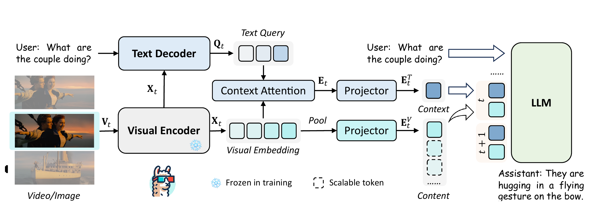

*LLaMA-VID 的方法总览图，引自原论文[12](#ref-12)。*

**LLaMA-VID：先解决“每帧占多少位置”。**图中每帧先由视觉编码器变成空间特征；用户指令生成文本查询，并通过 Context Attention 聚合与问题相关的视觉内容，形成一个 *context token*。另一条池化路径保留一个或少量 *content token*，补充不依赖当前问题的整体外观。于是每帧不再携带数百个 patch token，而是压成极少的语言模型输入 Token[12](#ref-12)。

**记忆视角：**它优化的是“载体压缩率”，使同一上下文窗口容纳更多帧；但查询相关的 context token 会随问题改变，content token 又是高度汇聚的表示。若之后换一个问题，被压掉的局部文字、计数或瞬时动作未必能恢复。

#### 模型剖析：TimeChat

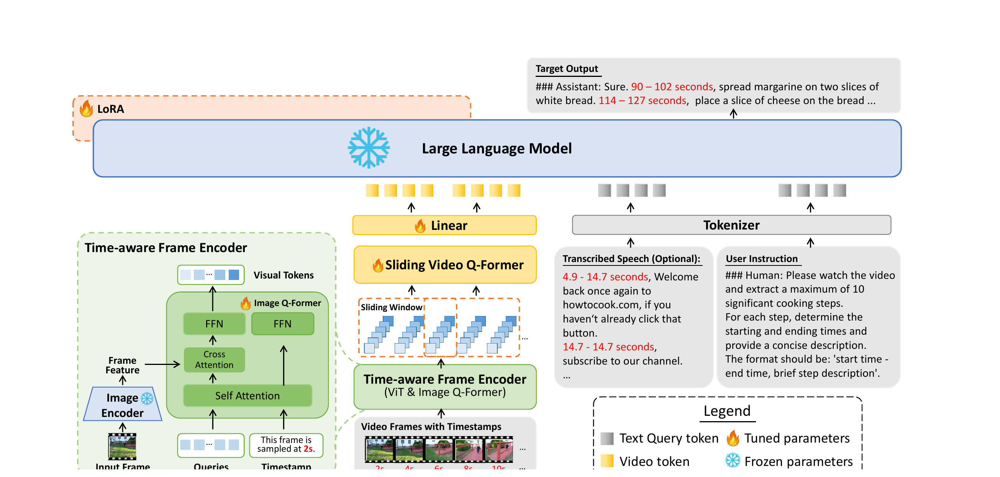

*TimeChat 的方法总览图，引自原论文[13](#ref-13)。*

**TimeChat：再解决“信息发生在何时”。**左下角的 Time-aware Frame Encoder 将帧特征与时间戳一起编码；中间的 Sliding Video Q-Former 用滑动窗口跨帧建立局部时间关系，再把压缩后的时序 Token 与可选语音转写、用户指令一同交给语言模型。图中的时间定位输出说明，表示不仅要包含“发生了什么”，还要保留可解码的起止时间[13](#ref-13)。

**系统判断：**LLaMA-VID 回答“怎样让历史装得下”，TimeChat 回答“怎样让历史仍可按时间寻址”。两者都适合作为记忆系统的编码前端，但图中都没有跨会话持久库、版本替换、删除传播或证据生命周期；因此它们展示的是长上下文表示的两个关键部件，而不是完整的长期记忆系统。

### 写出问题，而不是先选模型

一个完整任务规格可以写成六元组
$$
\mathcal{T}=\langle S,Q,E,C,L,G\rangle,
$$

其中 $S$ 是视频流条件，$Q$ 是查询到达方式，$E$ 是证据结构，$C$ 是算力与容量约束，$L$ 是延迟要求，$G$ 是治理要求。只有先给出 $\mathcal{T}$，才能讨论“哪种记忆最好”。

**实验：建立零号基线**

选择一段30–60分钟视频，构造20个问题并标注必要证据区间。实现均匀采样的直接问答基线，分别使用 16、32、64 和128帧。除答案准确率外，记录：总解码帧、视觉编码帧、输入Token、峰值显存和问题对应证据是否被采中。

**关键问题**

1. 若查询在索引时已经可见，系统获得了什么额外信息优势？
1. 为什么“输入帧数相同”仍不足以说明两个方法成本相同？
1. 设计一个总时长很短、但长期记忆难度很高的视频问题。

**本章小结：** 长视频的瓶颈不是单纯“装不进上下文”，而是在不确定未来查询的情况下，把有限观察和存储预算分配给真正有用的证据。长上下文必须作为对照，但长期记忆还要求增量写入、跨查询复用、可追溯读取和受控遗忘。

## 从视频 Token 到有状态系统

**本章目标**

- 掌握观察、写入、巩固、存储、读取、遗忘和推理七步生命周期；
- 区分五种主要记忆载体；
- 用“交互条件”判断论文之间是否可以公平比较；
- 为贯穿项目设计最小可用架构。

### 统一状态方程

设 $x_t$ 为时刻 $t$ 的视频观察，$E_v$ 为视觉编码器，$q$ 为当前查询，$b_t$ 为剩余预算。一个有状态视频系统可以写成
$$
\begin{aligned}
z_t &= E_v(x_t),\\
w_t &= \mathcal{W}(z_t,q,b_t),\\
m_t &= \mathcal{U}(m_{t-1},w_t),\\
\tilde m_t &= \mathcal{F}(m_t,b_t),\\
r_t &= \mathcal{R}(\tilde m_t,q,b_t),\\
y_t &= \mathcal{G}(q,r_t,z_t).
\end{aligned}
$$

这里的关键不在符号，而在每个算子都对应可测试问题：写入器是否漏掉事件？更新是否覆盖旧事实？遗忘是否误删稀有证据？读取是否召回正确时间片？生成器是否忠实使用证据？

### 七步生命周期

**表：长视频记忆生命周期及其最小诊断量**

| 阶段 | 核心决策 | 最小诊断量 |
| --- | --- | --- |
| 观察 | 何时采样、使用哪些模态 | 关键事件观察召回率、解码/编码帧数 |
| 写入 | 新信息是否值得保存 | 写入精确率、写入召回率、重复率 |
| 巩固 | 怎样合并事件和形成多尺度摘要 | 信息损失、摘要事实一致性 |
| 存储 | 载体、地址、容量和版本如何组织 | 容量增长、索引延迟、证据指针完整性 |
| 读取 | 如何为查询寻找和组合证据 | Recall@$k$、时间定位 IoU、调用次数 |
| 遗忘 | 何时替换、过期或删除 | 遗忘曲线、误删率、删除完整性 |
| 推理 | 如何生成答案并表达不确定性 | 给定金证据准确率、引用精确率、校准度 |

### 五种记忆载体

#### 原始帧与关键帧

优点是证据保真、可回看、容易展示给人；缺点是空间大、再次读取需要视觉编码。适合作为低频“档案层”，不适合全部放入快速工作记忆。

#### 视觉特征或 Token

表示紧凑、可以端到端优化，并能直接用于跨注意。缺点是难解释，换骨干模型后可能失效，压缩后的具体细节也难恢复。**MovieChat**、**MA-LMM** 和 **ReWind** 主要工作在这一层[15](#ref-15), [16](#ref-16), [17](#ref-17)。

#### 文本摘要与文档

压缩率高、易于全文检索，能够利用成熟的 LLM 推理。缺点是视觉事实被语言化，颜色、计数、空间关系和瞬时动作可能在第一次描述时就丢失。**LLoVi** 和 **DrVideo** 体现了这种路线[18](#ref-18), [19](#ref-19)。

#### KV Cache 与递归隐状态

它们适合流式复用计算，读取延迟低，但与模型内部层强耦合。**FlexMem** 把视觉 KV Cache 重新解释为可转移、压缩和按任务读取的记忆源[20](#ref-20)；**VideoLLaMB** 则通过循环记忆桥传播片段语义[21](#ref-21)。

#### 图和层次化多模态结构

这一载体可表达对象、事件、时间和空间关系，并在摘要与细节之间逐级展开。代价是分段、实体对齐、版本更新和冲突处理复杂。**VideoTree**、**WorldMM** 和 **VideoARM** 分别展示了树搜索、多记忆库和代理式层次记忆[22](#ref-22), [23](#ref-23), [24](#ref-24)。

### 四种交互条件

**表：交互条件决定方法拥有的信息和适用工作负载**

| 条件 | 系统可以做什么 | 典型应用 |
| --- | --- | --- |
| 离线、查询已知 | 看完整段视频，并按问题选择帧或Token | 单次基准问答、视频搜索 |
| 离线、查询未知 | 先建通用索引，再服务任意问题 | 电影、会议、个人视频档案 |
| 在线、被动查询 | 只能使用查询时刻之前的状态 | 直播助手、监控回溯 |
| 在线、主动响应 | 还要决定立即回答或等待未来证据 | 实时协作、机器人助手 |

把查询已知的 VideoAgent 或 VideoTree，与查询未知的持续记忆直接比较，会把“问题提前泄露”的收益误认为记忆机制的收益。同样，离线系统可以利用未来帧完成场景分段，而在线系统必须严格因果。

### 贯穿项目的最小架构

*贯穿项目采用的三层证据化记忆架构*

这里有一个重要的工程选择：语义摘要不直接替代视觉证据，而是保存时间范围和关键帧指针。检索先用便宜的摘要和向量定位，再用视觉档案核验。这种“概括负责导航、原始证据负责裁决”的结构将在后续章节反复出现。

**容易踩坑**

不要让答案生成器直接看到整个索引数据库。应先形成一个有长度上限的“证据包”，记录每条证据的来源、时间范围、召回分数和版本。否则很难区分检索错误与生成错误，也无法稳定控制上下文成本。

**实验：定义记忆数据结构**

为每个事件设计最小记录：`event_id`、起止时间、文本摘要、视觉特征、关键帧指针、涉及实体、父场景、置信度、版本和访问权限。再设计一次查询返回的证据包格式。要求每个生成句子都能引用至少一个 `event_id`。

**关键问题**

如果同一人物在两小时内三次移动一个物品，应该覆盖“物品位置”，还是追加三个事件？怎样同时支持“现在在哪里”和“此前在哪里”两类问题？

**本章小结**

记忆系统是一组带预算的生命周期操作。载体决定信息上限，读写策略决定哪些信息留下，交互条件决定系统在决策时知道什么。一个稳健的起点是把语义导航、情景时间线和视觉证据分层保存。

## 观察与事件分段：记忆从哪里开始

**本章目标**

- 理解观察策略是记忆性能的第一上限；
- 比较均匀采样、变化检测、问题感知采样和学习式选择；
- 掌握固定窗口、镜头和语义事件三种分段粒度；
- 为采样器建立成本与关键事件召回率的联合评价。

### 没看见的信息无法被记住

很多系统把“记忆失败”归因于容量不足，实际上关键帧从未进入重型编码器。设必要证据集合为 $E^\star$，观察器选中的时间集合为 $S$，可定义带容差 $\delta$ 的观察召回率
$$
R_o(\delta)=\frac{1}{|E^\star|}\sum_{e\in E^\star}\mathbf{1}\left[\exists s\in S,\ d(s,e)\leq\delta\right].
$$

如果 $R_o$ 很低，后续再强的压缩器和检索器也无法恢复证据。因此每个实验都应先画“观察成本—证据召回”曲线。

### 四类观察策略

#### 均匀采样

它可复现、无需训练，也是最重要的基线。弱点是把预算平均分配给静止和事件密集区域，容易漏掉短暂变化。均匀采样表现强时，复杂记忆机制未必值得。

#### 变化感知采样

使用镜头切换、像素差、特征距离、运动或音频能量加密采样。它不依赖问题，适合未知查询，但“变化大”不一定“语义重要”；投影片上的一个数字变化可能视觉差异小，却决定答案。

#### 问题感知采样

**Adaptive Keyframe Sampling**、**Flexible Frame Selection**、基于 M-LLM 的帧选择以及 **BOLT** 都尝试让有限帧更贴近查询[25](#ref-25), [26](#ref-26), [27](#ref-27), [28](#ref-28)。它们对单问题通常高效，却无法在问题未知时提前形成通用记忆。公平报告必须包含预扫描成本：选择器即使最终只返回32帧，也可能已经读取整段视频的轻量特征。

#### 学习式联合采样

**MSJoE** 联合演化采样器与 MLLM，使观察策略适应下游模型[29](#ref-29)。这种方法能突破手工分数的限制，但训练分布中的问题类型会决定“什么值得看”，迁移到未知任务时可能产生系统性盲点。

#### 模型剖析：LongVU

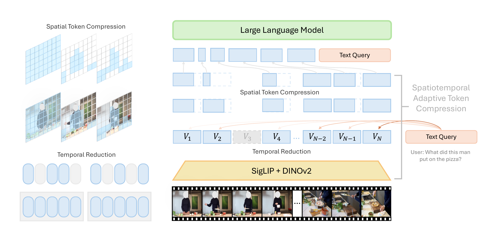

*LongVU 的时空自适应压缩总览图，引自原论文[30](#ref-30)。*

**图怎么读：**底部是密集采样的视频帧。LongVU 先用 DINOv2 特征比较邻近帧，在时间轴上去除高度相似的冗余帧；保留下来的帧再进入 SigLIP 与 DINOv2 双路视觉表示。中间一层根据文本查询决定哪些帧仍需较完整的空间 Token，哪些帧可以降到低分辨率；上层进一步利用跨帧时间依赖合并重复的空间位置，最后把压缩后的序列交给语言模型[30](#ref-30)。

**记忆对象与读写：**它没有显式数据库，而是在一次前向中把“哪些时刻、哪些区域值得保留”写成稀疏 Token 序列。读取就是语言模型对这些 Token 的注意力，因此地址仍是隐式位置，而不是可审计的事件 ID 或原始帧指针。

**关键取舍：**DINOv2 擅长保留视觉变化，文本查询又能强化任务相关区域，两者组合比均匀采样更精细；代价是压缩策略与当前问题耦合。一个对问题 A 不重要的路牌，可能恰好是问题 B 的唯一证据。公平评测还应把密集帧的轻量特征提取计入成本，而不能只报告最终送入 LLM 的 Token 数。

**系统判断：**LongVU 展示了三级预算分配：先删时间冗余，再按查询分配每帧空间预算，最后用时间相关性继续压缩。它是记忆系统“观察与写入前过滤”的强基线，但仍需外接持久地址、版本更新与证据级删除机制。

### 固定窗口、镜头还是事件

**表：三种常用分段单位**

| 单位 | 优点 | 主要问题 | 适合场景 |
| --- | --- | --- | --- |
| 固定窗口 | 简单、稳定、易批处理 | 边界切断事件，内容密度不均 | 流式原型、硬件流水线 |
| 镜头 | 视觉边界清楚 | 一件事可能跨镜头，讲座镜头长期不变 | 电影、剪辑视频 |
| 语义事件 | 与检索和摘要最一致 | 分段器本身会错，在线检测有延迟 | 会议、第一视角、行为过程 |

**VideoLLaMB** 使用 SceneTiling 将视频切为语义一致单元，再通过循环记忆桥传播片段间信息[21](#ref-21)。这提醒我们：分段不是无害预处理。边界过密会产生碎片和重复，边界过稀会让摘要混合多个事件；错误边界还会传播到写入、检索和回答。

### 一个可实现的通用观察器

对查询未知的长时视频服务，可以采用三级漏斗：

1. 低成本解码器按 1 FPS 生成缩略帧并读取音频能量、字幕和 OCR；
1. 变化检测器在镜头、文本、说话人或运动变化附近提高采样率；
1. 轻量视觉编码器为候选帧产生特征，事件分段器形成 5–60 秒片段；
1. 重型 MLLM 只为被判为新颖或高价值的事件生成描述和关键帧。

可用下式给候选片段打分：
$$
s_t=\alpha\,\text{novelty}_t+\beta\,\text{motion}_t+\gamma\,\text{text-change}_t
+\eta\,\text{entity-change}_t-\lambda\,\text{redundancy}_t.
$$

在未知查询条件下，权重不应依赖具体问题；它们可以通过事件覆盖、未来问题集合或主动学习调整。

**容易踩坑**

变化检测容易压低“持续状态”的价值。例如一个危险物品长时间留在桌面上，后续问题可能询问它持续了多久。只记录进入和离开时刻不够，事件表示还必须明确状态的有效区间。

**实验：比较四种采样器**

在同一视觉编码预算下比较均匀采样、镜头边界、特征新颖度和问题感知采样。按短暂动作、文字细节、跨事件因果和持续状态四类问题分别报告 $R_o$，并记录选择器扫描了多少帧、重型模型处理了多少帧。不要只报告最终问答准确率。

**关键问题**

1. 一个观察器在答案准确率上更高，却在关键证据召回率上更低，可能发生了什么？
1. 查询未知时，哪些信号可以近似“未来价值”？
1. 怎样避免语义事件分段器把同一事件在不同镜头间重复写入？

**本章小结**

观察器决定记忆的第一上限。均匀采样是必须保留的基线，问题感知选择拥有额外信息优势；语义事件是理想写入单位，但边界错误必须被当作系统误差测量。任何“只输入少量帧”的效率主张都应包含预扫描成本。

## 压缩式记忆：把历史折叠为有限状态

**本章目标**

- 理解固定容量记忆的写入、合并和替换机制；
- 比较相似度压缩、指令感知压缩和状态空间压缩；
- 分析压缩率、证据保真与可解释性之间的三角关系；
- 实现短期/长期双层 Token 记忆。

### 从保存全部到维护充分统计量

压缩式方法希望用大小受控的状态 $m_t$ 近似整个历史：
$$
m_t=\mathcal{U}(m_{t-1},z_t), |m_t|\leq K.
$$

理想状态应对未来任务保留“充分信息”，但未来问题通常未知。因此真正的矛盾是：容量 $K$ 固定时，系统如何在高频常见模式与低频关键细节之间分配表示。

### MovieChat：短期缓冲与长期合并

#### 模型剖析：MovieChat

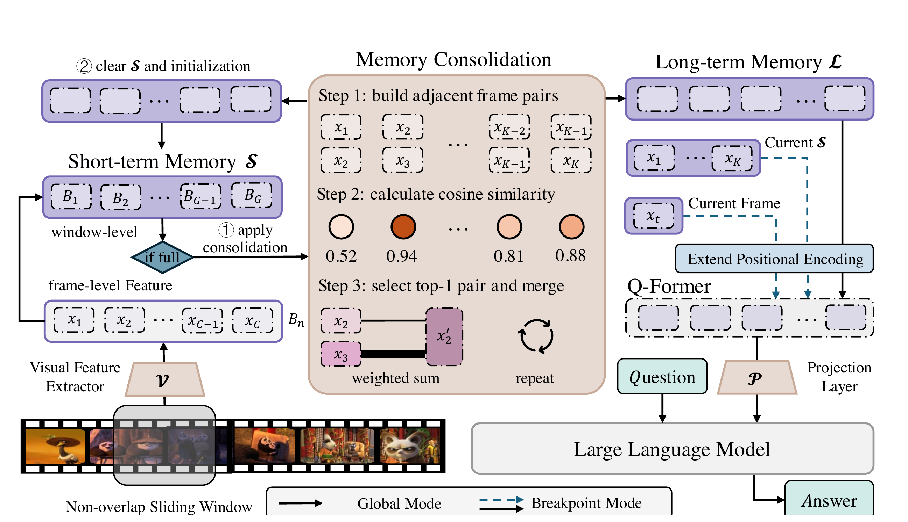

*MovieChat 的短期—长期记忆与合并机制，引自原论文[15](#ref-15)。*

**图怎么读：**左下角的非重叠滑窗把视频逐块送入视觉特征提取器，新 Token 先进入固定容量的短期记忆 $\mathcal{S}$。当 $\mathcal{S}$ 满时，中间的 Memory Consolidation 计算相邻 Token 对的余弦相似度，反复选择最相似的一对做加权合并；压缩结果写入长期记忆 $\mathcal{L}$，短期缓冲随后清空并继续接收新帧[15](#ref-15)。

**两种读取方式：**Global Mode 用长期记忆加当前短期记忆理解整段视频；Breakpoint Mode 则在指定时刻额外读取当前帧和短期状态，回答局部问题。图右侧的扩展位置编码负责告诉 Q-Former 不同记忆 Token 的顺序。

**关键取舍：**MovieChat 明确给出了“新观察 $\rightarrow$ 短期缓冲 $\rightarrow$ 巩固 $\rightarrow$ 长期状态”的写入链路，而不只是对整段视频做一次性池化。它的容量受控，但相似性并不等于任务价值：只出现一次的小动作可能被大面积相似背景吸收；反复合并也会累积表征漂移。

**工程补充：**实现时不应只保存合并向量，还要为每个长期 Token 维护覆盖时间段、代表帧、成员数量和离散度。这样即使语言模型读取的是压缩表示，系统仍能回到原始证据核验，也能定位某段视频派生出的所有记忆项。

可以把一次简单的相似度合并写成
$$
\begin{aligned}
(i,j)&=\arg\max_{i\neq j}\ \mathrm{sim}(m_i,m_j),\\
\hat m&=\frac{a_i m_i+a_j m_j}{a_i+a_j},
\end{aligned}
$$

其中 $a_i$ 记录 Token 代表的时间长度或样本数。只保留平均向量会破坏证据追踪，因此工程上还应维护被合并成员的时间范围、关键帧指针和方差。

### MA-LMM：在视觉侧持续写入

#### 模型剖析：MA-LMM

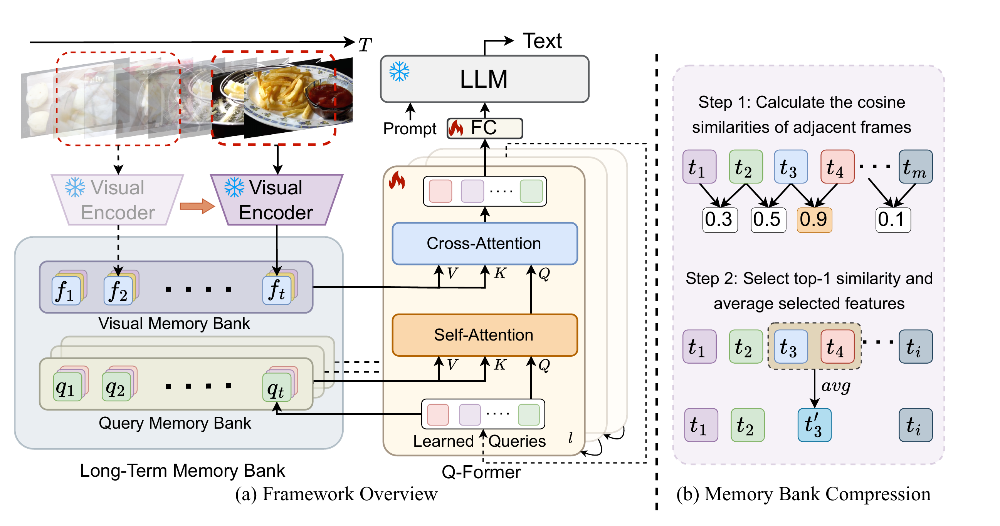

*MA-LMM 的双记忆库与在线压缩框架，引自原论文[16](#ref-16)。*

**图怎么读：**左侧视频帧按时间自回归到达。冻结的视觉编码器产生当前视觉特征 $f_t$，并写入 Visual Memory Bank；Q-Former 的学习查询与历史视觉特征做自注意、交叉注意，得到紧凑的查询表示 $q_t$，再写入 Query Memory Bank。后续时刻同时读取两类历史：原始视觉特征提供细节，历史查询提供已经提炼过的语义[16](#ref-16)。

**容量控制：**图右侧显示记忆库压缩：先计算相邻时刻表示的余弦相似度，选择最相似的一对做平均或加权替换，循环到满足容量上限。与 MovieChat 类似，它利用冗余换容量；不同之处在于 MA-LMM 把记忆增强放在视觉编码器与语言模型之间，可作为插件接入不同多模态架构。

**读取瓶颈：**长期记忆库可以保存较长历史，但每次 Q-Former 输出的学习查询数量仍固定。它们相当于有限的“读出槽”，必须同时承载人物、动作、文字、空间和因果等潜在需求。增加库容量并不自动增加下游可见信息，读取带宽同样需要单独报告。

**系统判断：**MA-LMM 清楚揭示“写入容量”和“读取容量”是两个不同预算。若要用于真正持久的系统，还需给库中每项增加时间地址和证据指针，并设计跨视频去重、删除与版本冲突处理；仅靠向量相似度合并无法完成这些生命周期操作。

MA-LMM 提醒我们区分两个容量：外部记忆库可以增长，但每次读取的查询 Token 数仍是信息瓶颈。如果跨注意只输出少量向量，下游生成器看到的仍是高度压缩的历史。

### ReWind 与 \texorpdfstring{AdaCM$^2$}{AdaCM2}：让文本指导压缩

**ReWind** 通过可学习查询和跨注意持续保存与指令有关的内容，再由语言模型完成推理[17](#ref-17)。**AdaCM$^2$** 利用跨模态相关性自适应削减视觉记忆[31](#ref-31)。它们都把问题或指令变成压缩先验：与当前任务无关的内容可以更大胆地丢弃。

这种优势带来一个边界：如果同一视频稍后出现新问题，原先被判断为无关的信息已经无法恢复。可将工作负载分为：

- **单问题工作负载：**问题感知压缩通常更有效；
- **多问题档案：**需要通用记忆，或允许查询到来后有限回看原视频；
- **在线未知查询：**写入时不能访问未来问题，应使用新颖度、事件边界和实体状态等通用价值。

### BIMBA 与 VAMBA：状态空间模型的长程传播

**BIMBA** 使用双向交错 Mamba 的选择性扫描，把长视频序列压缩为更短的信息密集 Token[32](#ref-32)；**VAMBA** 组合 Mamba 与 Transformer，在小时级视频中平衡线性状态传播和局部精细交互[33](#ref-33)。状态空间模型能以近线性成本传播历史，却仍有一个诊断问题：

$$
\text{状态传播很远} \not\Rightarrow \text{早期事实可以精确取回}.
$$

因此应插入“探针问题”：在不同延迟后查询相同类型事实，绘制正确率或证据可解码性随距离的曲线，而不是只看视频结束时的平均分。

### 压缩的三个不可兼得目标

*压缩式记忆的核心权衡*

一个实用折中是“双轨保存”：高频读取使用压缩 Token；低频核验使用外部关键帧指针。压缩状态负责回答“可能在哪里”，证据档案负责回答“究竟发生了什么”。

**实验：双层 Token 记忆**

实现容量分别为 $K_s$ 和 $K_l$ 的短期、长期记忆。短期按时间顺序写入；溢出时，将相邻高相似 Token 合并到长期层，同时保存时间范围和代表帧。比较 FIFO、相似度合并和“相似度+事件新颖度”三种策略。对每种策略绘制容量—准确率曲线和按证据延迟分组的遗忘曲线。

**容易踩坑**

不要只用平均池化后的问答准确率证明“记忆保留了信息”。增加两个对照：一是用金标准证据替换检索结果，测生成器上限；二是训练轻量探针，从不同时间的记忆状态解码事件标签，观察信息何时消失。

**关键问题**

1. 为什么“保留最不相似的 Token”仍可能漏掉关键事件？
1. 查询未知时，可学习写入器应该用什么监督信号？
1. KV Cache 压缩与语义事件摘要在删除个人信息时有什么不同？

**本章小结**

压缩式记忆把成本放在写入阶段，适合持续观看和频繁查询。MovieChat 展示双层合并，MA-LMM 展示视觉侧长期库，ReWind 与 AdaCM$^2$ 展示指令感知压缩，BIMBA/VAMBA 展示状态空间传播。其共同弱点是压缩损失不可逆，因此应保留证据指针并单独测量遗忘。

## 稀疏情景记忆：先定位，再推理

**本章目标**

- 把长视频问答分解为索引、召回、核验和推理；
- 比较文本、视觉、时间和实体四类索引信号；
- 理解 LLoVi、VideoAgent、DrVideo 和 VideoTree 的检索范式；
- 构建带时间戳与视觉指针的混合检索系统。

### 为什么检索适合稀疏证据

当答案只依赖少量片段时，把所有历史压成一个状态会在无关区域浪费容量。外部记忆改为保存地址明确的事件集合
$$
\mathcal{M}=\{(k_i,v_i,t_i,p_i,c_i)\}_{i=1}^{N},
$$

其中 $k_i$ 是检索键，$v_i$ 是摘要或特征，$t_i$ 是时间范围，$p_i$ 是原始证据指针，$c_i$ 是置信度与版本。查询阶段先召回少量候选，再让 MLLM 核验。

### LLoVi：把视频变成长文档

#### 模型剖析：LLoVi

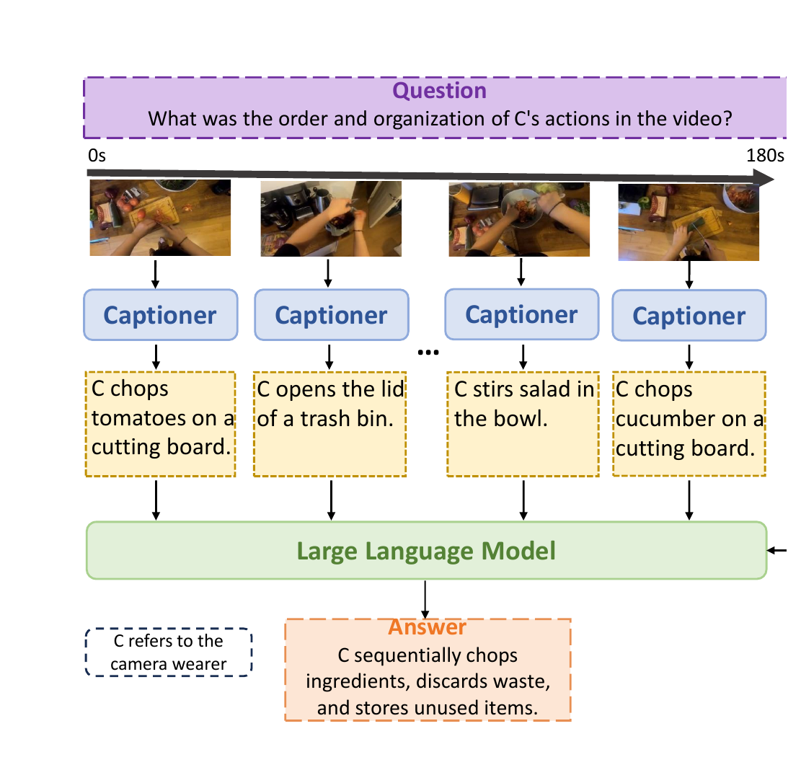

*LLoVi 的“短片段描述—长文本推理”总览图，引自原论文[18](#ref-18)。*

**图怎么读：**长视频先被切成短片段，每段由现成的视频描述器生成一句稠密 caption，并按时间顺序拼成长文档；问题与整份文档一起交给大语言模型，由 LLM 聚合分散在多个片段中的线索并生成答案。论文还使用多轮摘要提示，逐步压缩冗长、重复或带噪的描述[18](#ref-18)。

**为什么它强：**LLoVi 不训练新的长视频网络，而是把昂贵的视频推理改写为成熟的长文本推理。短视频描述器、LLM 和提示策略可以独立替换，因此它是检验复杂视频记忆结构是否真有增益的重要免训练基线。

**记忆视角：**写入对象是按时间排列的文本事件，读取依赖 LLM 的长文档注意力或后续检索。它天然便于搜索、摘要和审计，却把视觉信息压进了语言瓶颈：描述器没有说出的颜色、数量、空间关系、屏幕文字或瞬时动作，之后的 LLM 无法从文本中恢复。

**系统判断：**把它视为“高压缩语义索引”，而不是无损视频记忆。工程上应为每条 caption 保存起止时间和关键帧指针；当答案需要细节或多条描述冲突时，系统必须能回看原视频，而不是继续在可能错误的文本上推理。

为了减少语言化损失，文本事件应至少携带：起止时间、主要实体、动作、状态变化、OCR/字幕来源，以及一组可回看的关键帧指针。

### VideoAgent：问题驱动的主动搜索

#### 模型剖析：VideoAgent

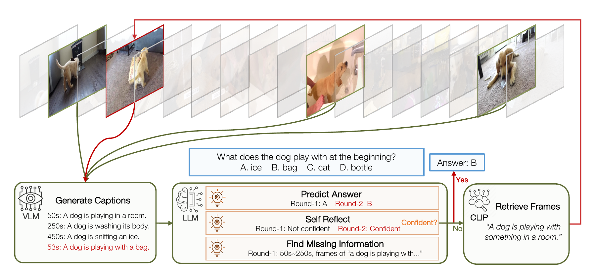

*VideoAgent 的迭代检索—反思框架，引自原论文[34](#ref-34)。*

**图怎么读：**系统先对少量均匀采样帧生成描述，让 LLM 获得视频概览。每一轮控制器先尝试回答并进行自反思：若证据不足，就把“还缺什么信息”写成检索描述；CLIP 在整段视频的轻量特征中召回候选帧，VLM 再把这些帧转成文字观察。新观察加入上下文后，LLM 再次判断是否已经足够[34](#ref-34)。

**记忆对象：**短期状态由概览 caption、已检索帧的描述、当前答案和置信判断组成；视频侧则保留可搜索的帧特征。读操作不是一次 Top-$k$，而是“预测—反思—找缺口—检索—观察”的多轮闭环，搜索路径会随问题变化。

**优势与边界：**主动感知把昂贵 VLM 调用集中到少量候选帧，尤其适合证据稀疏的问题；但问题在搜索前已经可见，因此它并没有提前构造可复用的通用记忆。LLM 的错误假设也会生成错误检索词，使后续搜索围绕早期偏见反复打转。

**公平评测：**除最终查看的帧数外，还必须计入全视频轻量特征扫描、CLIP 检索、每轮 VLM 调用和控制器推理 Token。建议记录每轮新增证据、答案变化与停止原因，才能判断代理是在有效搜索还是仅增加测试时计算。

可以把第 $j$ 次工具调用视为带成本动作 $a_j$，当期望信息增益低于成本时停止：
$$
\mathbb{E}[\Delta I(y; a_j)\mid h_j] < \lambda\,\mathrm{cost}(a_j).
$$

实际系统常用最大轮数或 LLM 自判停止，容易出现无效反复搜索。因此应记录每轮召回证据是否新增，以及答案置信度是否真正改变。

### DrVideo：文档导航与视觉补充

#### 模型剖析：DrVideo

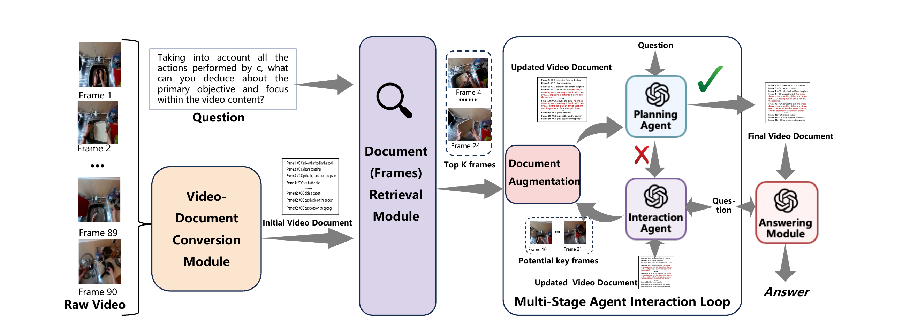

*DrVideo 的文档检索与多阶段代理交互框架，引自原论文[19](#ref-19)。*

**图怎么读：**左侧 Video-Document Conversion Module 先把长视频变成带时间顺序的粗粒度文档。问题到来后，Document Retrieval Module 从文档中定位相关片段及候选帧；中间的 Planning Agent 判断现有信息是否足够，若不足，Interaction Agent 请求视觉补充，Document Augmentation 把关键帧中的新细节写回更新后的文档。循环结束后，Answering Module 根据最终文档作答[19](#ref-19)。

**核心改进：**与纯文本 LLoVi 相比，DrVideo 多了一条“文本导航后回到视觉核验”的读路径。便宜的文档层负责高召回定位，昂贵的视觉层负责恢复颜色、数量、对象关系等 caption 容易遗漏的细节；写回操作又让后续轮次能够复用新增证据。

**薄弱入口：**若初始文档完全漏掉某个事件，与该事件相关的查询可能没有任何文本锚点，代理也就不知道该回看哪里。索引阶段因此应并行保留时间覆盖、新颖度、视觉近邻和音频/OCR 等非文本入口，避免所有检索都受第一次 caption 支配。

**系统判断：**DrVideo 是“语义索引＋原始证据库”双层设计的典型。落地时还要把每次文档增强标记为派生事实，保存来源帧、生成模型、置信度和版本；否则代理补写的错误描述会被后续轮次当成已经核实的事实。

DrVideo 给出一个普适架构：**便宜的语义层负责高召回导航，昂贵的视觉层负责高精度核验。**这与贯穿项目的三层记忆一致。

### VideoTree：粗到细的层次搜索

树检索本质上在分配查询预算。若节点 $u$ 的相关性为 $s(u,q)$、展开成本为 $c(u)$，可优先展开效用比最高的节点：
$$
u^*=\arg\max_{u\in\mathcal{C}}\frac{s(u,q)\cdot \mathrm{uncertainty}(u)}{c(u)}.
$$


#### 模型剖析：VideoTree

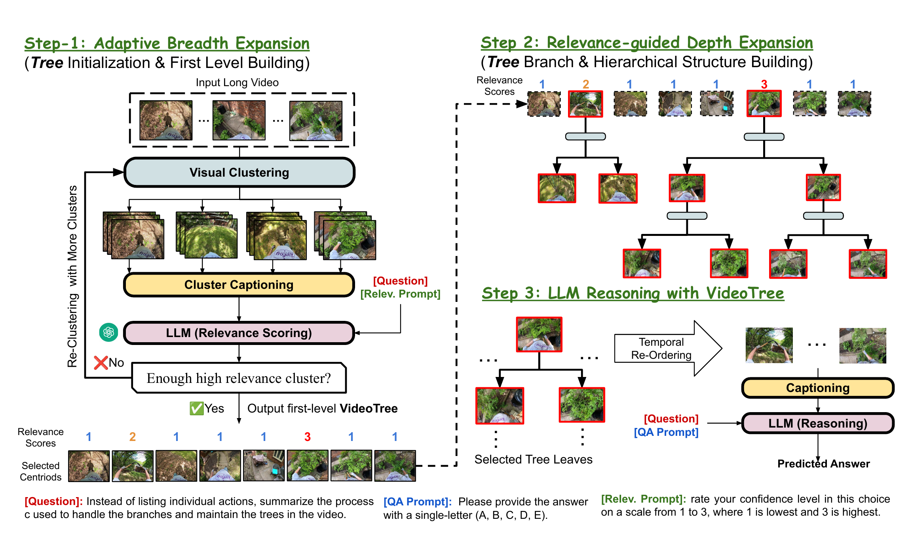

*VideoTree 的自适应宽度、深度扩展与推理流程，引自原论文[22](#ref-22)。*

**图怎么读：**第一步先对长视频帧做视觉聚类，为每个簇选择代表帧并生成 caption；LLM 根据问题给各簇打相关性分数。如果高相关簇数量不足，系统增加聚类数，进行 Adaptive Breadth Expansion。第二步只对高相关分支继续子聚类，形成 Relevance-guided Depth Expansion；越相关的区域获得越细的时间粒度。第三步收集选中的叶节点，恢复时间顺序并交给 LLM 推理[22](#ref-22)。

**记忆结构：**根和上层节点覆盖较长时间范围，提供粗语义；叶节点保存局部代表帧与描述。查询预算因此不是平均分给整段视频，而是沿少数相关分支逐层细化。相比一次性 Top-$k$，树结构还能表达“某个事件属于哪个较长阶段”。

**关键取舍：**方法免训练且适合事件层级明显、证据稀疏的离线视频；但树的宽度和深度由当前问题指导，不同问题可能重复聚类与扩展。若上层 caption 或相关性评分把关键分支判低，后续深搜也无法补救。

**系统判断：**VideoTree 展示了粗到细检索应同时分配“搜索宽度”和“时间分辨率”。将其升级为持久记忆时，可提前保存问题无关的基础树和节点证据，再在查询时建立轻量的任务视图，避免为每个问题重建整棵树。

### 混合检索比单一相似度更稳健

查询“第一次修改学习率后发生了什么”同时包含语义、顺序和时间约束。一个实用评分函数是
$$
s_i=\alpha s_{\text{text}}+\beta s_{\text{visual}}+\gamma s_{\text{time}}
+\eta s_{\text{entity}}-\rho s_{\text{redundancy}}.
$$

先用文本和实体获得高召回候选，再通过时间约束重排，并用视觉特征寻找描述遗漏的近邻。最终证据包应覆盖不同来源，而不是返回十条几乎相同的摘要。

**表：四类索引信号的互补关系**

| 信号 | 擅长 | 容易失败 |
| --- | --- | --- |
| 文本 | 概念、人物、动作、字幕内容 | 未语言化细节、描述幻觉 |
| 视觉 | 颜色、布局、相似场景和对象 | 抽象因果、复杂语言条件 |
| 时间 | 先后、邻近、持续区间 | 需要先找到锚点事件 |
| 实体 | 身份持续、对象状态轨迹 | 实体对齐和同名歧义 |

**实验：建立混合情景索引**

把视频切成事件，保存摘要、时间范围、文本向量、视觉向量和三张关键帧。实现 BM25/文本向量、视觉向量、时间过滤和加权融合四种检索。用带金标准时间区间的问题评估 Recall@1/5/10 与时间 IoU；然后固定检索结果，单独测回答器准确率。

**容易踩坑**

答案正确但证据错误可能来自语言捷径或选项排除。评价时要求模型返回证据时间戳，并设置“移除关键片段”“打乱视频顺序”“只给问题”对照。正确答案必须同时满足证据命中，才能算作真正的视频记忆成功。

**本章小结**

检索式记忆保留可定位证据，适合离线索引、多次查询和稀疏事件。LLoVi 强在文本化，VideoAgent 强在主动搜索，DrVideo 强在文档导航后视觉核验，VideoTree 强在层次预算分配。其性能上限转移到“索引是否写入”和“查询是否召回”。

## 递归与流式记忆：在视频到来时思考

**本章目标**

- 理解在线系统的因果性、稳态容量和响应时机；
- 比较长上下文缓存、金字塔记忆、双层流式记忆和循环桥；
- 掌握在线评测中的过去、当前和未来三类查询；
- 设计不会随视频长度无限增长的流式状态。

### 在线不是把离线模型逐块调用

查询在时刻 $t_q$ 到达时，严格在线系统只能使用 $x_{\leq t_q}$：
$$
p(y_{t_q}\mid x_{1:T},q)=p(y_{t_q}\mid x_{\leq t_q},q), t_q<T.
$$

它不能利用未来帧确定场景边界，也不能为每个问题从头重放历史。除此之外，还要回答两个离线系统不必面对的问题：状态是否长期稳定？问题需要未来证据时，系统应该立即拒答还是继续等待？

### VideoLLM-online：训练格式决定时间意识

#### 模型剖析：VideoLLM-online

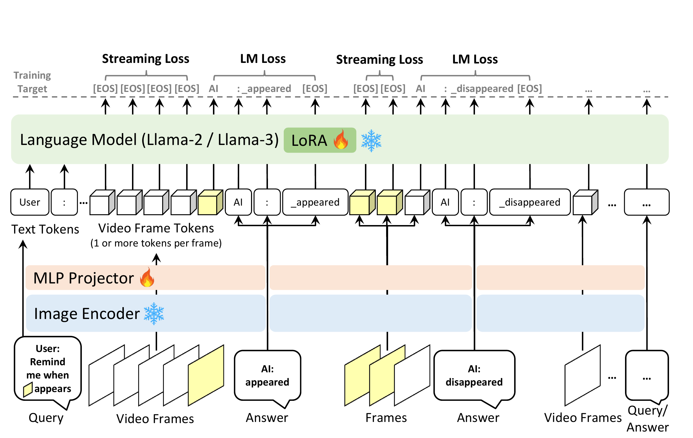

*VideoLLM-online 的 LIVE 流式训练方法，引自原论文[35](#ref-35)。*

**图怎么读：**LIVE 将用户问题、连续到达的视频帧和助手回答按真实时间顺序交错成一个自回归序列。图中视频帧经冻结图像编码器与可训练投影层变成视觉 Token，语言模型既计算普通 LM Loss，也在每个帧位置计算 Streaming Loss：事件尚未发生或无需发言时预测 EOS，证据到达后才输出语言[35](#ref-35)。

**训练数据的作用：**论文把离线时间标注改写为流式对话，让同一问题在不同时间点面对不同可见证据。这样，时间因果约束不是靠提示语临时声明，而是进入监督信号：模型学习“何时回答、何时保持沉默”，并能把响应与当前视频时刻对齐。

**在线状态：**推理时视觉 Token 和历史语言进入持续 KV Cache，优化流水线让视频编码与生成并行。它解决了流中对话和实时响应，却没有从根本上限定长期状态大小；缓存、原始上下文和对话历史仍可能随时间增长。

**系统判断：**VideoLLM-online 是在线记忆研究的强起点，因为它把“只能使用过去证据”写进数据与损失。但面向小时、天级连续流，还需额外的容量控制、摘要巩固、过期事实更新与可验证遗忘；否则它是不断增长的工作记忆，而不是稳定的长期记忆。

### VideoChat-Online：多时间尺度金字塔

与 OVBench 一同提出的 **VideoChat-Online** 使用金字塔记忆，以高时间分辨率保存近期细节，以低分辨率保留较远历史[36](#ref-36)。这种结构符合“越近越细、越远越概括”的一般规律：
$$
\mathcal{M}=\bigcup_{\ell=0}^{L-1}\mathcal{M}^{(\ell)},
\Delta t_{\ell+1}>\Delta t_{\ell}, K_{\ell+1}\leq K_{\ell}.
$$

固定层级更新简单稳定，但信息密度突变时容易错配。例如三分钟实验演示比三十分钟静态讲授更需要细粒度容量，时间距离不是唯一价值信号。

### Flash-VStream：概括导航与细节增强


#### 模型剖析：Flash-VStream

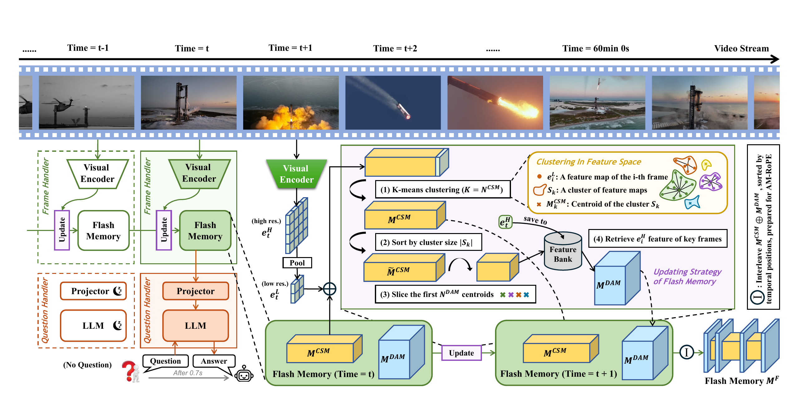

*Flash-VStream 的双进程与 Flash Memory 总览图，引自原论文[37](#ref-37)。*

**图怎么读：**Frame Handler 持续接收视频，用低分辨率特征更新 Flash Memory，同时把部分高分辨率特征放入 Feature Bank；Question Handler 与它异步运行，问题到来时无需暂停视频编码。两条进程通过共享的 Flash Memory 协作，从而把持续观察与偶发问答解耦[37](#ref-37)。

**两类记忆：**Context Synopsis Memory（CSM）容量较小，用聚类中心概括长程时间信息，并近似刻画哪些时段信息密度高；Detail Augmentation Memory（DAM）容量较大，根据 CSM 的分布从 Feature Bank 取回代表关键帧的高分辨率特征。最终读出把 CSM 与 DAM 交错，使语言模型同时看到全局脉络和局部细节。

**为什么有效：**长期历史主要以低成本概括状态更新，只有信息密集的时刻占用高分辨率容量；问答又与写入异步，因此响应延迟不必随视频长度线性增加。这个结构比统一压缩率更贴近真实视频中“长时间平稳、少数时刻突变”的分布。

**风险与复用原则：**聚类中心若把罕见但关键事件当作离群噪声，DAM 就不会保留其细节；CSM 与 Feature Bank 的时间地址若不同步，也会取回错误帧。可复用的工程原则是：概括层负责导航、细节层负责核验，两层必须共享稳定的事件 ID、时间范围与证据指针。

### VideoLLaMB 与 FlexMem：内部状态的两种利用

**VideoLLaMB** 使用循环记忆桥和时间记忆 Token，在 SceneTiling 得到的片段之间传递语义[21](#ref-21)。它把每个场景看作递归更新单元，适合连续视频；若场景边界错误或递归更新偏离，误差会累积到后续状态。

**FlexMem** 直接将视觉 KV Cache 作为记忆源，通过双路径压缩进行记忆转移，并按任务选择读取策略[20](#ref-20)。它免训练、可插拔，但 KV 表示与具体骨干和层绑定，跨模型持久化、语义级删除和人工审计较困难。

**表：四种流式设计的关注点**

| 系统 | 核心机制 | 主要诊断问题 |
| --- | --- | --- |
| VideoLLM-online | 时间交错训练与连续响应 | 状态是否随流无限增长 |
| VideoChat-Online | 多分辨率金字塔记忆 | 固定层级是否适应内容密度 |
| Flash-VStream | 上下文/增强双层记忆 | 两层是否一致，细节能否按需召回 |
| VideoLLaMB / FlexMem | 循环桥或视觉KV转移 | 误差累积、骨干耦合和可删除性 |

### 何时回答也是决策

OVBench 按过去、当前和未来组织在线任务[36](#ref-36)；OVO-Bench 进一步测试向后追溯、实时理解和主动等待[38](#ref-38)。若问题“接下来谁会进门”在 $t_q$ 尚无答案，系统不应编造。设最早可答时刻为 $t^\star$，响应时机误差可写为
$$
e_{\text{time}}=|\hat t-t^\star|,
$$

并分别惩罚过早回答与不必要等待。在线系统应输出三种状态：*可答*、*证据不足需等待*、*历史已遗忘*。

### 稳态系统的预算检查

运行时间为 $T$ 时，应报告：状态大小 $|m_T|$ 是常数、对数增长还是线性增长；每小时视觉编码、写入和巩固成本；稳态吞吐是否高于视频到达速率；查询与后台巩固并发时的 P50/P95 延迟；以及早期事件在10分钟、1小时和更久后的召回曲线。

**实验：因果流式模拟器：** 按真实时间顺序向系统送入片段，并在预定时刻插入问题。API 严格禁止读取未来帧。实现近期高分辨率队列、长期摘要队列和关键事件档案三个层级。测试1、2、4小时流，确认稳态内存不增长，并分别测回溯、当前和等待未来证据三类任务。

**容易踩坑：** 许多所谓“online”实验仍在视频播放结束后统一提问。要验证真正因果性，应在数据加载器和存储层设置时间闸门，并用故意放在未来的诱饵证据测试模型是否泄露。

**本章小结：** 流式系统必须同时满足因果性、稳态容量、实时吞吐和响应时机。VideoLLM-online 强调时间交错训练，VideoChat-Online 强调金字塔状态，Flash-VStream 强调概括与细节双层分工，VideoLLaMB/FlexMem 强调内部状态复用。评价必须随运行时间展开，而不是只在终点打分。

## 层次化与代理式记忆：让系统主动管理证据

**本章目标**

- 理解情景、语义和视觉记忆的分工；
- 处理对象状态变化、摘要冲突和多尺度证据；
- 比较 WorldMM、Embodied VideoAgent、VideoARM、LVAgent 和 LongVT；
- 把记忆操作建模为带成本的工具调用。

### 为什么单一记忆库不够

“发言人在第42分钟更正了公式”是情景事实；“本次评审采用对比学习”是跨事件抽象的语义事实；“公式右下角的下标究竟是什么”则需要视觉证据。把三者都存成相同向量，会迫使一个载体同时承担时间定位、概念概括和像素级核验。

层次化系统可以写成
$$
\mathcal{M}=\mathcal{M}_{\text{episodic}}\cup\mathcal{M}_{\text{semantic}}\cup\mathcal{M}_{\text{visual}},
$$

并要求每条语义事实保留指向情景事件的支持边，每个事件再保留指向原始帧的证据边。

### WorldMM：三类记忆协同

#### 模型剖析：WorldMM

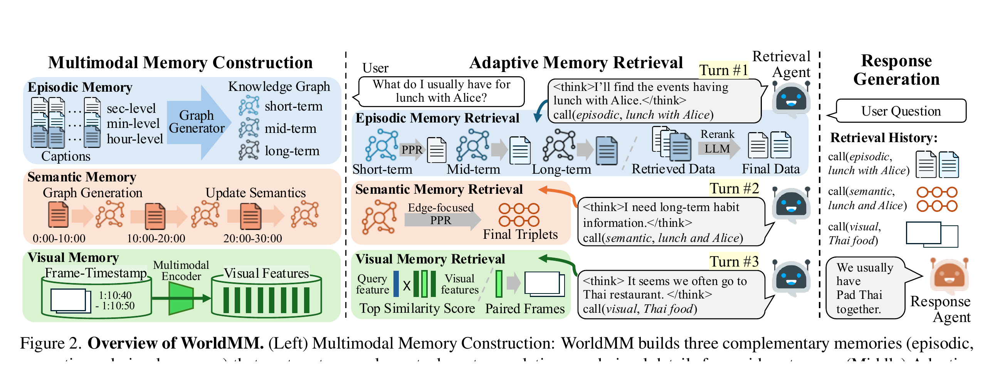

*WorldMM 的多模态记忆构建与自适应检索框架，引自原论文[23](#ref-23)。*

**图怎么读：**左侧同时构建三类记忆：Episodic Memory 在秒、分钟、小时等多尺度上组织事件 caption；Semantic Memory 把连续事件更新成较稳定的关系与概念；Visual Memory 保存带时间戳的帧及视觉特征。中间的 Retrieval Agent 根据问题反复选择记忆类型和时间粒度，重排候选并把检索历史交给右侧响应代理[23](#ref-23)。

**为什么不只用一个库：**“午饭何时发生”适合查情景时间线；“这个人通常和谁一起吃饭”需要跨事件语义关系；“盘子里具体是什么菜”又必须回到视觉细节。WorldMM 的关键不是简单增加三个数据库，而是让代理按证据需求路由，并在多轮检索中判断信息是否已经充分。

**写入与更新：**情景记忆保留事实与时间范围，语义记忆随着新片段持续更新高层知识，视觉记忆则承担不可被文字概括替代的核验责任。三者应通过共同事件 ID 互相引用；否则同一事件的摘要、关系和帧特征会变成无法追踪的三份副本。

**主要风险：**多库系统会产生重复、冲突和过期事实。语义记忆可能概括出“通常如此”，而新的情景证据已经推翻它；检索代理也可能在不同库之间循环。工程上需要来源边、时间有效区间、版本关系和最大检索预算，停止条件应同时考虑证据覆盖与新增信息量。

当摘要与视觉证据冲突时，不应简单让 LLM 投票。可以定义证据优先级：原始带时间戳证据高于派生描述，新版本事实高于旧版本当前状态，但历史查询仍可访问旧版本。每个结论都保存 `supports`、`contradicts` 和 `supersedes` 边。

### Embodied VideoAgent：记忆世界状态

#### 模型剖析：Embodied VideoAgent

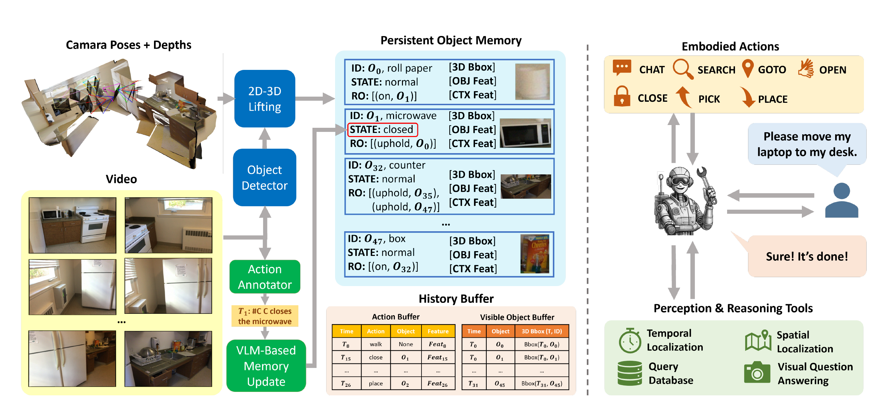

*Embodied VideoAgent 的持久对象记忆、更新与工具框架，引自原论文[39](#ref-39)。*

**图怎么读：**第一视角视频提供外观与动作，深度图和相机位姿通过 2D--3D lifting 把检测对象放入统一三维坐标系。Persistent Object Memory 为每个对象保存 ID、状态、空间关系、3D 包围盒、对象外观特征和环境上下文特征；VLM-Based Memory Update 在检测到人与物交互后修改对象状态，历史缓冲则记录动作和可见对象[39](#ref-39)。

**如何读取：**LLM 代理可调用时间定位、空间定位、数据库查询和视觉问答工具；若请求涉及实际操作，还能触发搜索、移动、抓取、放置、开关等动作原语。这里的记忆不只回答“发生了什么”，还要提供“物体现在在哪里、处于什么状态、能否操作”的世界状态。

**最难的写入问题：**同一物体从不同视角重现时必须保持身份；被拿走、遮挡或放回后，系统又要区分“没看见”和“已不存在”。覆盖式更新会丢失历史，因此每次状态改变都应作为带时间和证据的事件追加，再由解析器计算指定时刻的当前状态。

**系统判断：**与电影问答不同，错误记忆会直接导致导航或操作失败。评价除语言答案外，还应包含闭环任务成功率、对象重识别错误、过期事实率、空间定位误差和更新延迟；这也是从视频问答走向具身长期记忆时必须增加的系统指标。

对象状态不宜用覆盖式单值字段表示。更稳健的是事件溯源：
$$
\text{state}(o,t)=\operatorname*{resolve}\{e_i:o_i=o,\ t_i\leq t\},
$$

其中 *resolve* 根据时间、置信度和证据来源计算指定时刻的状态。这既支持当前查询，也能回答历史状态。

### VideoARM：边推理边构建层次记忆

#### 模型剖析：VideoARM

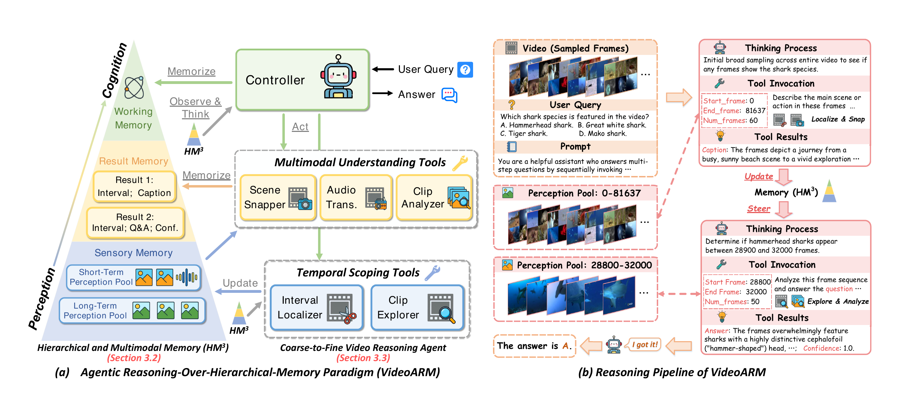

*VideoARM 的层次记忆与粗到细代理推理流程，引自原论文[24](#ref-24)。*

**图怎么读：**左半部分是 Controller 驱动的“观察—思考—行动—记忆”循环。控制器先读取低成本的长期感知池，再调用 Interval Localizer 或 Clip Explorer 缩小时间范围；需要语义证据时，再调用场景、音频、片段分析等多模态工具。右半部分示例展示代理先粗看全局，随后围绕两个候选时间段逐步细化并更新判断[24](#ref-24)。

**三层记忆：**Sensory Memory 含长期与短期感知池，保存当前可探索的原始多模态线索；Result Memory 记录工具输出、分析区间和置信度，避免重复观察；Working Memory 外置控制器的目标与推理轨迹，使工具调用后可以清理模型上下文而不丢失计划。三层分别服务感知、证据和认知控制。

**与预先索引的区别：**VideoARM 不先穷举整段视频的所有 caption，而是在问题到来后动态构建与当前推理相关的层次记忆。它适合证据位置未知、多跳且允许多轮调用的任务，也能把 Token 预算集中到最有希望的时间段。

**公平评测：**收益可能来自更大的测试时计算，因此比较时必须固定骨干模型、工具集合、最大调用数、可读取帧数与推理 Token，并报告成功答案前的累计延迟。还应检查 Result Memory 是否真正减少了重复调用，以及错误的早期时间定位能否被后续工具纠正。

### LVAgent 与 LongVT：协作和原生工具调用

**LVAgent** 让多个 MLLM 代理进行多轮协作、反思和重新检索[40](#ref-40)。多代理可以分工搜索与核验，却会引入重复调用、意见耦合和更高方差。需要记录每个代理新增了什么证据，而不是只展示自然语言讨论轨迹。

**LongVT** 通过原生工具调用训练模型学习何时定位和读取视频证据，并提供相应训练数据[41](#ref-41)。相比手写“先搜索再回答”的提示，它把调用策略纳入模型能力；但策略质量依赖训练数据和奖励是否真正鼓励证据充分而非答案捷径。

### 带成本的记忆控制器

将动作集合设为
$$
\mathcal{A}=\{\text{查摘要},\text{查事件},\text{看关键帧},\text{扩展时间窗},\text{更新记忆},\text{停止}\}.
$$

控制器的目标可以写为受预算约束的效用最大化：
$$
\begin{aligned}
\max_{\pi} &\mathbb{E}_{\pi}\left[U(y,E)-\sum_j c(a_j)\right]\\
\text{s.t.} &\sum_j c_{\text{latency}}(a_j)\leq B_l,
\sum_j c_{\text{token}}(a_j)\leq B_t.
\end{aligned}
$$

实际实现中，可以先用规则控制：至少获得两个独立证据；若摘要置信度低则回看帧；连续两轮没有新增证据则停止；证据冲突时扩展相邻时间窗。

### 防止代理把错误写回长期记忆

代理生成的“推断”不应自动成为事实。写回前至少区分：

- **观察事实：**直接由帧、字幕或传感器支持；
- **派生结论：**由多个事实推理得到，可撤销；
- **用户声明：**来源是交互而非视频；
- **系统假设：**用于后续搜索，默认不进入长期语义记忆。

每次写回带来源类型、支持证据和模型版本。只有观察事实可以作为高置信度锚点；派生结论在发现冲突后需要重算。

**实验：实现一个证据控制器：** 在第五章混合检索器之上增加六种动作。先使用规则策略，再尝试让 LLM 选择动作。固定最大调用数为6，记录每轮候选、证据增益、Token和延迟。比较一次检索、规则控制器和 LLM 控制器在多跳问题上的性能—成本曲线。

**容易踩坑：** 自然语言轨迹看起来合理，不代表代理真正使用了视频。对每个工具返回结果做反事实实验：替换、删除或打乱关键证据，检查最终答案是否随之改变。若答案不变，代理可能依赖先验而非记忆。

**本章小结：** 层次化记忆通过情景、语义和视觉三层兼顾时间、概括与细节；代理则动态决定读写和回看。WorldMM 展示多库协同，Embodied VideoAgent 展示动态世界状态，VideoARM/LVAgent/LongVT 展示不同的工具控制方式。越动态的系统越必须核算调用成本、约束写回来源并验证证据因果性。

## 训练记忆：监督信号从哪里来

**本章目标**

- 区分模块化训练、端到端训练与免训练组合；
- 为观察器、写入器、检索器和回答器分别构造监督；
- 理解查询已知训练与未知查询部署之间的偏移；
- 设计预算约束下的联合目标。

### 先决定哪些模块需要学习

并非所有系统都要端到端训练。可以沿三条路线构建：

1. **免训练组合：**冻结视觉模型和 LLM，用规则分段、向量库与工具调用快速建立基线。VideoAgent、VideoTree、DrVideo 和 FlexMem 体现了不同形式的插件式思路[34](#ref-34), [22](#ref-22), [19](#ref-19), [20](#ref-20)。
1. **模块化训练：**单独训练帧选择器、事件检索器或压缩器，便于诊断和替换。
1. **端到端训练：**让表示、写入、读取和回答共同适配任务，例如 MA-LMM、ReWind 和 BIMBA[16](#ref-16), [17](#ref-17), [32](#ref-32)。

免训练路线开发快、迁移方便，但往往增加测试时调用；端到端路线推理紧凑，却需要长视频训练数据和显存。公平比较应分开报告训练成本与推理成本。

### 四类监督信号

#### 观察与写入监督

若数据带有必要证据区间 $E^\star$，可以将证据附近片段作为正例；但只用当前问题标注，会把写入器训练成问题专用选择器。为了服务未知查询，可将同一视频的多个问题合并，或使用事件边界、对象状态变化、字幕新信息和未来可预测性构造通用价值标签。

#### 压缩与巩固监督

除了最终答案损失，还可加入：
- 重建关键帧特征或事件标签；
- 保持压缩前后问答分布一致；
- 对关键事件施加较高保留权重；
- 约束相邻时间片的状态更新平滑，但允许突发事件快速改变。

#### 检索监督

给定查询 $q$、正证据 $e^+$ 和负证据 $e^-$，可使用对比损失
$$
\mathcal{L}_{\text{ret}}=-\log\frac{\exp s(q,e^+)/\tau}{\exp s(q,e^+)/\tau+\sum_{e^-}\exp s(q,e^-)/\tau}.
$$

困难负例应包括同一人物的相似事件、相邻但无关片段和字幕相似的诱饵；随机负例太容易，无法训练时间与因果区分。

#### 生成与引用监督

回答器不仅预测答案，还应预测引用的事件 ID 或时间区间。可把损失写成
$$
\mathcal{L}_{\text{gen}}=\mathcal{L}_{\text{answer}}+\lambda_c\mathcal{L}_{\text{citation}}
+\lambda_u\mathcal{L}_{\text{uncertainty}}.
$$

无证据问题应包含“无法从已观察视频确认”的目标输出，否则模型会把流畅回答当作唯一优化方向。

### 预算应进入目标函数

只优化答案损失，模型会倾向观察更多帧、保存更多 Token、调用更多工具。一个简单的受预算目标为
$$
\mathcal{L}=\mathcal{L}_{\text{answer}}+\lambda_r\mathcal{L}_{\text{ret}}
+\lambda_m\max(0,|m|-K)+\lambda_f C_{\text{FLOPs}}+\lambda_l C_{\text{latency}}.
$$

部署有硬上限时，可使用拉格朗日乘子动态调整，或直接在训练中固定观察帧、记忆槽和调用数，避免只在测试时截断。

### 从离线训练到在线部署

离线训练常能看到完整视频和问题，在线部署却只能看到过去帧。应采用因果掩码和时间切片构造训练样本，并包含“需要等待”的例子。VideoLLM-online 和 VideoChat-Online 都说明时间交错的指令格式本身是一项重要设计[35](#ref-35), [36](#ref-36)。

**容易踩坑：** 如果写入器训练时看到问题和选项，而部署时查询未知，它学习到的是后验筛选而不是通用记忆。训练日志必须明确每个模块在每个时刻可见哪些信息。

**实验：模块化训练检索器：** 使用第十一章的数据格式，从金标准证据区间生成正片段，并构造同实体、相邻时间和字幕相似三类困难负例。冻结视频与文本编码器，只训练一个融合评分头。比较随机负例与困难负例对 Recall@5、时间 IoU 和最终回答准确率的影响。

**关键问题：** 为什么用最终答案损失端到端训练，仍可能得到证据错误的系统？怎样构造训练信号使“答案正确但引用错误”受到惩罚？

**本章小结：** 训练记忆的关键是给生命周期各阶段可诊断的监督，并把容量和调用成本写进目标。问题感知监督容易产生后验优势；未知查询系统需要跨问题、跨事件的通用写入信号。引用和“不知道”同样应成为训练目标。

## 评价与错误诊断：准确率只是最后一层

**本章目标**

- 熟悉主要长视频与在线基准的覆盖边界；
- 建立观察、记忆、推理和系统四层指标；
- 用三阶段误差模型定位性能瓶颈；
- 设计可复现、可证据化的公平比较。

### 主要基准在测什么

**表：代表性基准及其评测用途**

| 基准 | 主要特点 | 适合诊断 | 主要局限 |
| --- | --- | --- | --- |
| EgoSchema | 第一视角、约3分钟、选择题 | 跨时间因果与时间证书 | 单域、选项捷径 |
| LongVideoBench | 最长约1小时、字幕交错 | 时间指代与证据定位 | 字幕可能替代视觉 |
| Video-MME | 多时长、多模态设置 | 视频/字幕/音频对照 | 采样与提示差异影响大 |
| MLVU | 多任务、选择与生成混合 | 不同理解能力 | 总平均分掩盖子任务 |
| LVBench | 小时级、六类时间能力 | 极长视频退化 | 样本量和内容先验 |
| OVBench/OVO-Bench | 查询位于时间轴中 | 回溯、当前、主动等待 | 系统吞吐指标仍需补充 |
| SceneBench | 场景级长期问题 | 场景遗忘与 Scene-RAG | 聚焦单类失效 |

EgoSchema、LongVideoBench、Video-MME、MLVU 和 LVBench 分别扩大了第一视角、长上下文、多模态、多任务和极长视频覆盖[9](#ref-9), [10](#ref-10), [42](#ref-42), [43](#ref-43), [44](#ref-44)。OVBench 与 OVO-Bench 将问题放回播放时间轴[36](#ref-36), [38](#ref-38)；SceneBench 强调按场景观察遗忘[11](#ref-11)。没有单一基准能同时验证通用写入、多查询复用、严格在线、证据引用与部署成本。

### 四层评价协议

#### 观察层

报告关键事件观察召回率、重型模型处理帧数、候选重复率，以及按事件持续时间分组的漏检率。

#### 记忆层

报告给定查询的证据 Recall@$k$、时间定位 IoU、记忆中金事件是否仍存在，以及随延迟和干扰数量增长的遗忘曲线。

#### 推理层

用金标准证据直接喂给回答器，测 $A_g$；再用系统召回证据测实际准确率。二者差距反映检索与证据组织问题。开放问答除 LLM 评分外，应抽样人工核验事实和引用。

#### 系统层

报告每小时写入成本、峰值/稳态显存、存储增长、索引时间、P50/P95 首响应延迟、吞吐、工具调用数和生成 Token。对在线系统还要验证未来信息隔离。

### 三阶段误差模型

设观察/写入召回为 $R_w$，查询检索召回为 $R_r$，给定正确证据后的推理正确率为 $A_g$。在简化独立假设下，最终准确率近似受
$$
A\lesssim R_w R_r A_g
$$

约束。它不是精确概率模型，却是很好的诊断框架。例如 $R_w=0.8$、$R_r=0.75$、$A_g=0.9$ 时，上限只有约0.54；继续扩大语言模型而不改写入和检索，收益有限。

*把最终错误分解到生命周期中的三个阶段*

### 必须控制的混杂因素

跨论文比较至少对齐：骨干与模型规模、视觉编码器、最终输入帧与全视频预扫描成本、分辨率、查询是否在写入时可见、字幕/音频设置、训练数据、提示与 CoT、API版本、答案解析、硬件、精度和缓存。Apollo 的系统探索也说明采样帧率、视频时长和模型设计需要联合分析[45](#ref-45)。

**实验：最小公平比较**

选择压缩式与检索式各一个方法，固定同一视觉编码器和回答模型。设置相同的重型视觉编码帧预算、证据包 Token 上限和生成 Token。分别报告索引一次问一次、索引一次问20次两种工作负载的总成本和平均准确率。

**容易踩坑**

选择题准确率容易受到选项长度、位置偏好和语言排除法影响。至少加入 `question-only`、`subtitle-only`、打乱视频和移除关键片段四种对照；如果模型在关键片段被移除后仍能回答，应重新检查数据与评分协议。

**本章小结：** 基准覆盖的是不同切面，不是统一排行榜。完整评价需要观察、记忆、推理和系统四层指标；三阶段误差模型帮助决定下一步应该改写入器、检索器还是回答器。任何效率结论都必须同时核算写入与查询成本。

## 工程化：证据、版本、删除与安全

**本章目标**

- 设计可版本化、可审计的事件存储；
- 处理事实更新、摘要冲突和过期信息；
- 理解持续视频记忆的隐私删除和提示注入风险；
- 建立适合真实部署的记忆模型卡。

### 从向量库升级为证据库

生产系统不能只保存 `embedding + text`。建议每条事件包含：

| 字段 | 作用 |
| --- | --- |
| `event_id/version` | 稳定地址与版本，避免更新后引用漂移 |
| `start/end_time` | 时间定位、顺序和持续区间 |
| `summary` | 便宜检索和上下文组织 |
| `visual_pointers` | 原视频、关键帧或短片段的不可变指针 |
| `entities/relations` | 人物、对象、动作和状态变化 |
| `source_modality` | 区分视觉、字幕、音频、OCR和用户输入 |
| `confidence` | 感知置信度，不等于生成器的语言自信 |
| `supports/` `contradicts` | 证据依赖和冲突关系 |
| `acl/retention` | 权限、保留期限和删除范围 |

摘要应该是派生缓存，而不是唯一事实源。当摘要模板或模型升级时，可以从保留的事件与证据重新生成；当视觉证据已按策略删除，则应显式标记“仅剩派生摘要”。

### 追加、覆盖还是版本化

假设系统先看到“杯子在桌上”，后来看到杯子被移入柜子。直接覆盖会失去历史，纯追加又会让当前查询收到两个冲突答案。版本化事件保留完整时间线，再由状态解析器回答指定时间的状态。

对于结论更新，可采用：
- 原始观察不可变；
- 当前状态由事件流解析得到；
- 语义总结可以新版本替代旧版本；
- 每个版本保留生成模型、提示和支持证据；
- 冲突未解决时并列返回证据，而不是强行融合。

### 遗忘是系统功能

遗忘策略可基于先进先出、相似度替换、访问频率、任务价值、保留期限或隐私请求。统一价值函数可以写成
$$
v_i=\alpha\,\text{novelty}_i+\beta\,\text{future-use}_i+\gamma\,\text{evidence-quality}_i
-\eta\,\text{redundancy}_i-\rho\,\text{privacy-risk}_i.
$$

但任何自动价值都会带偏差。低清晰度、少数语言或辅助设备相关事件可能系统性得到低分，从而转化为不均等的“被记住概率”。应按人群、光照、语言和设备报告写入召回。

### 级联删除

删除原视频并不代表忘记。目标主体的信息可能存在于关键帧、裁剪图、视觉向量、文本摘要、实体图、KV Cache、搜索日志和备份中。删除请求应：

1. 解析目标时间、主体和权限范围；
1. 查找原始证据及所有派生对象；
1. 删除或重写受影响摘要与索引；
1. 使缓存和备份按策略失效；
1. 用重识别、成员推断或特定查询验证残留；
1. 记录不含敏感内容的审计凭证。

潜在状态和 KV Cache 比显式事件更难做语义级删除，这也是外部证据存储的重要工程优势。

### 持久提示注入

视频中的字幕、屏幕文字或语音可能包含“忽略用户要求”等恶意指令，并被摘要器写入长期记忆，在未来查询中再次触发。防御原则包括：

- 将视频内容始终标记为不可信数据，而不是系统指令；
- 检索结果使用结构化字段与转义边界；
- 工具调用策略不直接服从证据文本中的命令；
- 写入前检测可执行提示模式，并保存原文与中性描述的分离版本；
- 定期测试跨查询、跨会话的攻击持久性。

### 记忆模型卡

每个系统至少公开：写入时可见信息、载体与容量单位、采样和替换规则、查询重扫范围、工具调用上限、字幕/音频设置、证据引用格式、硬件与精度、模型版本、随机种子、数据污染检查、隐私保留和删除协议。

**实验：冲突与删除演练**

向系统依次注入对象位置变化、字幕更正和一条恶意屏幕指令。验证当前状态查询、历史状态查询、冲突证据返回和提示隔离。随后删除一个人物的10分钟视频，检查关键帧、向量、摘要、实体索引和查询缓存是否全部失效。

**本章小结：** 可靠记忆系统保存带来源、时间、版本和权限的证据链，而非无主向量。事实更新依赖事件溯源，遗忘需可解释，删除须覆盖派生数据；视频内容必须作为不可信输入隔离。

## 贯穿项目：从基线到完整系统

**本章目标**

本章把前面模块组装为一个可复现实验项目。完成后，系统应能对30分钟至2小时视频进行一次索引、多次查询，返回答案、证据时间戳与关键帧，并在固定预算下比较至少三种记忆策略。

### 项目任务与数据格式

建议先使用会议、访谈或公开视频，避免一开始处理复杂版权和隐私。每个问题记录：

- 问题、标准答案与答案类型；
- 一个或多个必要证据时间区间；
- 推理类型：定位、顺序、计数、状态、因果、多跳；
- 模态依赖：视觉、字幕、音频、OCR或混合；
- 最早可答时刻与是否允许未知回答；
- question-only、subtitle-only 是否可答。

至少构造50个问题，其中三分之一需要跨片段证据，三分之一依赖视觉细节，另三分之一涉及状态变化或顺序。

### 五个递进里程碑

#### M0：均匀采样基线

均匀选择16/32/64/128帧，直接送入同一 MLLM。记录采样命中与准确率，建立后续方法必须超过的强基线。

#### M1：可复用事件索引

用固定窗口或语义分段生成事件摘要、时间戳、文本/视觉向量和关键帧。实现一次索引、多次查询，输出 Top-$k$ 证据包。

#### M2：短期/长期压缩

增加近期 Token 队列和长期合并状态，比较 FIFO、相似度合并和价值感知合并。所有潜在 Token 仍保留事件指针。

#### M3：层次混合记忆

建立场景—事件—关键帧层次，以及情景、语义、视觉三种检索入口。先用摘要导航，再用视觉核验。

#### M4：动态证据控制器

允许系统执行查摘要、展开事件、查看关键帧、扩大时间窗和停止五类动作。固定最大调用数，比较规则控制器与 LLM 控制器。

### 推荐系统接口

```python
index(video, budget) -> memory_id, index_report
query(memory_id, question, query_budget) -> {
  answer, confidence, evidence[], actions[], cost
}
delete(memory_id, subject_or_interval) -> deletion_report
audit(memory_id) -> capacity, versions, orphan_pointers
```

`index_report` 必须包含解码帧、轻/重编码帧、事件数、Token数、存储量和总时间；`evidence[]` 包含事件ID、起止时间、模态、关键帧和召回分数。

### 统一预算矩阵

**表：项目建议预算设置**

| 预算 | 小 | 中 | 大 |
| --- | --- | --- | --- |
| 重型视觉编码帧/小时 | 180 | 720 | 1800 |
| 稳态事件/Token容量 | 512 | 2048 | 4096 |
| 每问候选事件 | 5 | 10 | 20 |
| 每问视觉回看片段 | 2 | 6 | 12 |
| 代理最大工具调用 | 2 | 4 | 8 |

具体数值可随硬件调整，但所有方法必须在同一预算列比较。另做“一次索引问1题、20题、100题”三个工作负载，以展示索引摊销。

### 评分表

**表：项目建议评分构成**

| 维度 | 权重 | 要求 |
| --- | --- | --- |
| 答案与证据质量 | 25% | 答案准确、证据 Recall 和引用精确率 |
| 系统设计 | 20% | 生命周期完整、接口清楚、载体选择有依据 |
| 公平实验 | 20% | 对齐骨干、模态、写入和查询预算 |
| 错误分析 | 15% | 分离未观察、遗忘、未召回和推理错误 |
| 效率与复现 | 10% | 日志、配置、随机种子、P95延迟和存储 |
| 安全与治理 | 10% | 冲突、删除、未知回答和提示隔离 |

### 必须提交的六张图

1. 答案准确率—重型编码帧数曲线；
1. 证据 Recall@$k$ 曲线；
1. 按证据时间距离分组的遗忘曲线；
1. 写入成本与多查询摊销曲线；
1. 三阶段错误分解图；
1. 准确率—P95延迟或工具调用数的 Pareto 前沿。

**容易踩坑**

项目不以“模型越大越好”为目标。优先固定同一回答模型，让改进能归因于记忆。若使用闭源 API，必须记录调用日期、模型版本、提示、重试规则和总调用成本，并提供一个开放模型替代基线。

**本章小结**

最终项目的产物不是一个演示，而是一套可重复的系统实验：一次索引、多次查询、答案绑定证据、成本完整核算、错误可以定位、删除可以验证。达到这些条件后，再追求更高基准分数才有意义。

## 研究前沿：从“看得更长”到“记得更好”

**本章目标**

- 把开放问题转化为可证伪假设；
- 识别查询未知、证据溯源、长度外推和跨会话记忆中的研究空白；
- 为开题报告设计清晰的自变量、对照和成功判据。

### 预算约束下的联合读写

现有工作常单独优化采样、压缩或检索，但真实系统共享同一算力与延迟预算。可检验假设是：在相同总 FLOPs 和 P95 延迟下，联合学习“是否观察、是否写入、保留多久、检索几次”优于各模块独立优化。MSJoE 已展示采样器与 MLLM 联合演化的潜力[29](#ref-29)，下一步应扩展到未知查询和在线流。

### 查询未知的可复用记忆

许多强方法在选择或压缩时已经看到问题。更接近长期记忆的协议是：先在无查询条件下索引视频，隔离索引环境，然后随机到达一系列问题。研究指标不是单问峰值，而是
$$
\text{ReuseGain}(N)=\frac{C_{\text{rescan}}(N)-C_{\text{index+query}}(N)}{C_{\text{rescan}}(N)},
$$

并要求准确率不因复用显著下降。

### 可解释遗忘与长度外推

构造内容相同、延迟不同、干扰密度不同的时间梯度，可以回答系统究竟在何时遗忘。成功标准不应是“平均分略高”，而是训练长度之外仍保持预定证据召回下界，且失效能由容量或替换规则解释。SceneBench 对场景遗忘的研究提供了重要起点[11](#ref-11)。

### 证据保真与冲突纠正

摘要应携带不可变视觉指针；当语义记忆与视觉证据冲突时，系统回看原始证据并修正派生结论。可通过主动注入摘要错误、字幕更正和对象改名，测量冲突发现率、恢复率和错误持续时间。WorldMM 与 VideoARM 的多库/层次机制为这类研究提供了架构基础[23](#ref-23), [24](#ref-24)。

### 跨视频、跨会话和世界变化

多天第一视角或多次会议需要同时保存情景历史和更新语义知识。开放问题包括实体跨会话对齐、重复事件去重、概念更新、容量分配和用户级权限。Embodied VideoAgent 说明视频记忆与空间世界状态结合的价值[39](#ref-39)，但真正长期部署还需要处理环境变化和错误回滚。

### 可检验研究议程

**表：从开放方向到实验判据**

| 方向 | 假设 | 核心实验 | 成功判据 |
| --- | --- | --- | --- |
| 联合预算 | 联合读写优于独立模块 | 固定总FLOPs、容量与P95延迟 | 准确率和证据召回同时提高 |
| 未知查询 | 通用记忆在多问时优于每问重扫 | 先隔离索引，再随机到达问题 | 总成本下降且首问不退化 |
| 证据溯源 | 摘要加视觉指针可减少幻觉 | 注入摘要错误与冲突事实 | 引用精确率和恢复率提升 |
| 解释遗忘 | 价值感知替换优于FIFO | 控制延迟、干扰和事件稀有度 | 长度外推保持召回下界 |
| 隐私删除 | 跨层级联删除优于只删原片 | 重识别、成员推断与查询攻击 | 攻击成功率接近未见样本 |
| 跨会话 | 情景/语义分离减少覆盖 | 多天视频与反复状态更新 | 当前与历史查询同时提升 |

### 怎样判断一个选题是否足够好

一个清晰的长视频记忆课题通常能回答：

1. 它优化生命周期中的哪一步？
1. 相比长上下文、均匀采样和简单检索，新增机制是什么？
1. 写入时能否看到问题，信息条件是否公平？
1. 在哪个预算轴上更优，代价转移到哪里？
1. 能否用证据级指标证明改善不是语言模型捷径？
1. 训练长度以外、未知查询或多次查询时是否仍成立？

**贯穿案例：一个合格的研究问题**

与其问“能否用分层记忆提高长视频问答准确率”，不如问：“在索引时查询未知、稳态容量为2048事件、每问最多回看6个片段的条件下，价值感知的情景—视觉双层记忆能否比 FIFO、相似度合并和每问重扫，在2–8小时长度外推上同时提高证据 Recall@10 和多查询总效用？”

**本章小结**

下一阶段的关键不是让模型宣称“支持更多帧”，而是让系统在何时写入、保存什么、如何召回、何时等待以及何时承认遗忘方面形成可测量决策。好的研究问题必须固定信息条件和预算，并用证据级实验支持机制结论。

## 参考文献

<span id="ref-1"></span>1. Vaswani, Ashish; Shazeer, Noam; Parmar, Niki; Uszkoreit, Jakob; Jones, Llion; Gomez, Aidan N.; et al. “Attention Is All You Need.” *Advances in Neural Information Processing Systems, 30, 2017*.

<span id="ref-2"></span>2. Bertasius, Gedas; Wang, Heng; Torresani, Lorenzo. “Is Space-Time Attention All You Need for Video Understanding?” *Proceedings of the 38th International Conference on Machine Learning: 813–824, 2021*.

<span id="ref-3"></span>3. Arnab, Anurag; Dehghani, Mostafa; Heigold, Georg; Sun, Chen; Lucic, Mario; Schmid, Cordelia. “ViViT: A Video Vision Transformer.” *Proceedings of the IEEE/CVF International Conference on Computer Vision: 6836–6846, 2021*.

<span id="ref-4"></span>4. Liu, Ze; Ning, Jia; Cao, Yue; Wei, Yixuan; Zhang, Zheng; Lin, Stephen; et al. “Video Swin Transformer.” *Proceedings of the IEEE/CVF Conference on Computer Vision and Pattern Recognition: 3202–3211, 2022*.

<span id="ref-5"></span>5. Beltagy, Iz; Peters, Matthew E.; Cohan, Arman. “Longformer: The Long-Document Transformer.” *arXiv preprint arXiv:2004.05150, 2020*.

<span id="ref-6"></span>6. Jaegle, Andrew; Gimeno, Felix; Brock, Andrew; Vinyals, Oriol; Zisserman, Andrew; Carreira, Joao. “Perceiver: General Perception with Iterative Attention.” *Proceedings of the 38th International Conference on Machine Learning: 4651–4664, 2021*.

<span id="ref-7"></span>7. Gu, Albert; Goel, Karan; Re, Christopher. “Efficiently Modeling Long Sequences with Structured State Spaces.” *International Conference on Learning Representations, 2022*.

<span id="ref-8"></span>8. Gu, Albert; Dao, Tri. “Mamba: Linear-Time Sequence Modeling with Selective State Spaces.” *Conference on Language Modeling, 2024*.

<span id="ref-9"></span>9. Mangalam, Karttikeya; Akshulakov, Raiymbek; Malik, Jitendra. “EgoSchema: A Diagnostic Benchmark for Very Long-Form Video Language Understanding.” *Advances in Neural Information Processing Systems, 36, 2023*.

<span id="ref-10"></span>10. Wu, Haoning; Li, Dongxu; Chen, Bei; Li, Junnan. “LongVideoBench: A Benchmark for Long-Context Interleaved Video-Language Understanding.” *Advances in Neural Information Processing Systems, 37, 2024*.

<span id="ref-11"></span>11. Chen, Seng Nam; Chen, Hao; Ho, Chenglam; Mao, Xinyu; Wang, Jinping; Zhang, Yu; et al. “Seeing the Scene Matters: Revealing Forgetting in Video Understanding Models with a Scene-Aware Long-Video Benchmark.” *Proceedings of the IEEE/CVF Conference on Computer Vision and Pattern Recognition: 4515–4525, 2026*.

<span id="ref-12"></span>12. Li, Yanwei; Wang, Chengyao; Jia, Jiaya. “LLaMA-VID: An Image Is Worth 2 Tokens in Large Language Models.” *Proceedings of the European Conference on Computer Vision, 2024*.

<span id="ref-13"></span>13. Ren, Shuhuai; Yao, Linli; Li, Shicheng; Sun, Xu; Hou, Lu. “TimeChat: A Time-Sensitive Multimodal Large Language Model for Long Video Understanding.” *Proceedings of the IEEE/CVF Conference on Computer Vision and Pattern Recognition: 14313–14323, 2024*.

<span id="ref-14"></span>14. Liu, Hao; Zaharia, Matei; Abbeel, Pieter. “World Model on Million-Length Video and Language with RingAttention.” *arXiv preprint arXiv:2402.08268, 2024*.

<span id="ref-15"></span>15. Song, Enxin; Chai, Wenhao; Wang, Guanhong; Zhang, Yucheng; Zhou, Haoyang; Wu, Feiyang; et al. “MovieChat: From Dense Token to Sparse Memory for Long Video Understanding.” *Proceedings of the IEEE/CVF Conference on Computer Vision and Pattern Recognition: 18221–18232, 2024*.

<span id="ref-16"></span>16. He, Bo; Li, Hengduo; Jang, Young Kyun; Jia, Menglin; Cao, Xuefei; Shah, Ashish; et al. “MA-LMM: Memory-Augmented Large Multimodal Model for Long-Term Video Understanding.” *Proceedings of the IEEE/CVF Conference on Computer Vision and Pattern Recognition: 13504–13514, 2024*.

<span id="ref-17"></span>17. Diko, Anxhelo; Wang, Tinghuai; Swaileh, Wassim; Sun, Shiyan; Patras, Ioannis. “ReWind: Understanding Long Videos with Instructed Learnable Memory.” *Proceedings of the IEEE/CVF Conference on Computer Vision and Pattern Recognition: 13734–13743, 2025*.

<span id="ref-18"></span>18. Zhang, Ce; Lu, Taixi; Islam, Md Mohaiminul; Wang, Ziyang; Yu, Shoubin; Bansal, Mohit; et al. “A Simple LLM Framework for Long-Range Video Question-Answering.” *arXiv preprint arXiv:2312.17235, 2023*.

<span id="ref-19"></span>19. Ma, Ziyu; Gou, Chenhui; Shi, Hengcan; Sun, Bin; Li, Shutao; Rezatofighi, Hamid; et al. “DrVideo: Document Retrieval Based Long Video Understanding.” *Proceedings of the IEEE/CVF Conference on Computer Vision and Pattern Recognition: 18936–18946, 2025*.

<span id="ref-20"></span>20. Chen, Tao; Zhang, Kun; Wu, Qiong; Chen, Xiao; Chang, Chao; Sun, Xiaoshuai; et al. “Scaling the Long Video Understanding of Multimodal Large Language Models via Visual Memory Mechanism.” *Proceedings of the IEEE/CVF Conference on Computer Vision and Pattern Recognition: 31877–31888, 2026*.

<span id="ref-21"></span>21. Wang, Yuxuan; Song, Yiqi; Xie, Cihang; Liu, Yang; Zheng, Zilong. “VideoLLaMB: Long Streaming Video Understanding with Recurrent Memory Bridges.” *Proceedings of the IEEE/CVF International Conference on Computer Vision: 24170–24181, 2025*.

<span id="ref-22"></span>22. Wang, Ziyang; Yu, Shoubin; Stengel-Eskin, Elias; Yoon, Jaehong; Cheng, Feng; Bertasius, Gedas; et al. “VideoTree: Adaptive Tree-Based Video Representation for LLM Reasoning on Long Videos.” *Proceedings of the IEEE/CVF Conference on Computer Vision and Pattern Recognition: 3272–3283, 2025*.

<span id="ref-23"></span>23. Yeo, Woongyeong; Kim, Kangsan; Yoon, Jaehong; Hwang, Sung Ju. “WorldMM: Dynamic Multimodal Memory Agent for Long Video Reasoning.” *Proceedings of the IEEE/CVF Conference on Computer Vision and Pattern Recognition: 25599–25609, 2026*.

<span id="ref-24"></span>24. Yin, Yufei; Meng, Qianke; Chen, Minghao; Ding, Jiajun; Shao, Zhenwei; Yu, Zhou. “VideoARM: Agentic Reasoning over Hierarchical Memory for Long-Form Video Understanding.” *Proceedings of the IEEE/CVF Conference on Computer Vision and Pattern Recognition: 24042–24051, 2026*.

<span id="ref-25"></span>25. Tang, Haoyu; Zhou, Yushi; Zhang, Yicong; Wang, Qixun; Lin, Wenxuan; Zhao, Yanwei; et al. “Adaptive Keyframe Sampling for Long Video Understanding.” *Proceedings of the IEEE/CVF Conference on Computer Vision and Pattern Recognition: 29118–29128, 2025*.

<span id="ref-26"></span>26. Buch, Shyamal; Nagrani, Arsha; Arnab, Anurag; Schmid, Cordelia. “Flexible Frame Selection for Efficient Video Reasoning.” *Proceedings of the IEEE/CVF Conference on Computer Vision and Pattern Recognition: 29071–29082, 2025*.

<span id="ref-27"></span>27. Hu, Kai; Gao, Feng; Nie, Xiaohan; Zhou, Peng; Tran, Son; Neiman, Tal; et al. “M-LLM Based Video Frame Selection for Efficient Video Understanding.” *Proceedings of the IEEE/CVF Conference on Computer Vision and Pattern Recognition: 13702–13712, 2025*.

<span id="ref-28"></span>28. Liu, Shuming; Zhao, Chen; Xu, Tianqi; Ghanem, Bernard. “BOLT: Boost Large Vision-Language Model Without Training for Long-Form Video Understanding.” *Proceedings of the IEEE/CVF Conference on Computer Vision and Pattern Recognition: 3318–3327, 2025*.

<span id="ref-29"></span>29. Tan, Wenhui; Yu, Xiaoyi; Li, Jiaze; Chen, Yijing; Ju, Jianzhong; Luo, Zhenbo; et al. “MSJoE: Jointly Evolving MLLM and Sampler for Efficient Long-Form Video Understanding.” *Proceedings of the IEEE/CVF Conference on Computer Vision and Pattern Recognition: 19487–19496, 2026*.

<span id="ref-30"></span>30. Shen, Xiaoqian; Xiong, Yunyang; Zhao, Changsheng; Wu, Lemeng; Chen, Jun; Zhu, Chenchen; et al. “LongVU: Spatiotemporal Adaptive Compression for Long Video-Language Understanding.” *Proceedings of the 42nd International Conference on Machine Learning, 267, 2025*.

<span id="ref-31"></span>31. Man, Yuanbin; Huang, Ying; Zhang, Chengming; Li, Bingzhe; Niu, Wei; Yin, Miao. “AdaCM2: On Understanding Extremely Long-Term Video with Adaptive Cross-Modality Memory Reduction.” *Proceedings of the IEEE/CVF Conference on Computer Vision and Pattern Recognition: 8534–8544, 2025*.

<span id="ref-32"></span>32. Islam, Md Mohaiminul; Nagarajan, Tushar; Wang, Huiyu; Bertasius, Gedas; Torresani, Lorenzo. “BIMBA: Selective-Scan Compression for Long-Range Video Question Answering.” *Proceedings of the IEEE/CVF Conference on Computer Vision and Pattern Recognition: 29096–29107, 2025*.

<span id="ref-33"></span>33. Ren, Weiming; Ma, Wentao; Yang, Huan; Wei, Cong; Zhang, Ge; Chen, Wenhu. “VAMBA: Understanding Hour-Long Videos with Hybrid Mamba-Transformers.” *Proceedings of the IEEE/CVF International Conference on Computer Vision: 21197–21208, 2025*.

<span id="ref-34"></span>34. Wang, Xiaohan; Zhang, Yuhui; Zohar, Orr; Yeung-Levy, Serena. “VideoAgent: Long-Form Video Understanding with Large Language Model as Agent.” *Proceedings of the European Conference on Computer Vision: 58–76, 2024*.

<span id="ref-35"></span>35. Chen, Joya; Lv, Zhaoyang; Wu, Shiwei; Lin, Kevin Qinghong; Song, Chenan; Gao, Difei; et al. “VideoLLM-online: Online Video Large Language Model for Streaming Video.” *Proceedings of the IEEE/CVF Conference on Computer Vision and Pattern Recognition: 18407–18418, 2024*.

<span id="ref-36"></span>36. Huang, Zhenpeng; Li, Xinhao; Li, Jiaqi; Wang, Jing; Zeng, Xiangyu; Liang, Cheng; et al. “Online Video Understanding: OVBench and VideoChat-Online.” *Proceedings of the IEEE/CVF Conference on Computer Vision and Pattern Recognition: 3328–3338, 2025*.

<span id="ref-37"></span>37. Zhang, Haoji; Wang, Yiqin; Tang, Yansong; Liu, Yong; Feng, Jiashi; Jin, Xiaojie. “Flash-VStream: Efficient Real-Time Understanding for Long Video Streams.” *Proceedings of the IEEE/CVF International Conference on Computer Vision: 21059–21069, 2025*.

<span id="ref-38"></span>38. Niu, Junbo; Li, Yifei; Miao, Ziyang; Ge, Chunjiang; Zhou, Yuanhang; He, Qihao; et al. “OVO-Bench: How Far Are Your Video-LLMs from Real-World Online Video Understanding?” *Proceedings of the IEEE/CVF Conference on Computer Vision and Pattern Recognition: 18902–18913, 2025*.

<span id="ref-39"></span>39. Fan, Yue; Ma, Xiaojian; Su, Rongpeng; Guo, Jun; Wu, Rujie; Chen, Xi; et al. “Embodied VideoAgent: Persistent Memory from Egocentric Videos and Embodied Sensors Enables Dynamic Scene Understanding.” *Proceedings of the IEEE/CVF International Conference on Computer Vision: 6342–6352, 2025*.

<span id="ref-40"></span>40. Chen, Boyu; Yue, Zhengrong; Chen, Siran; Wang, Zikang; Liu, Yang; Li, Peng; et al. “LVAgent: Long Video Understanding by Multi-Round Dynamical Collaboration of MLLM Agents.” *Proceedings of the IEEE/CVF International Conference on Computer Vision: 20237–20246, 2025*.

<span id="ref-41"></span>41. Yang, Zuhao; Wang, Sudong; Zhang, Kaichen; Wu, Keming; Leng, Sicong; Zhang, Yifan; et al. “LongVT: Incentivizing Thinking with Long Videos via Native Tool Calling.” *Proceedings of the IEEE/CVF Conference on Computer Vision and Pattern Recognition: 33816–33826, 2026*.

<span id="ref-42"></span>42. Fu, Chaoyou; Dai, Yuhan; Luo, Yongdong; Li, Lei; Ren, Shuhuai; Zhang, Renrui; et al. “Video-MME: The First-Ever Comprehensive Evaluation Benchmark of Multi-Modal LLMs in Video Analysis.” *Proceedings of the IEEE/CVF Conference on Computer Vision and Pattern Recognition: 24108–24118, 2025*.

<span id="ref-43"></span>43. Zhou, Junjie; Shu, Yan; Zhao, Bo; Wu, Boya; Liang, Zhengyang; Xiao, Shitao; et al. “MLVU: Benchmarking Multi-Task Long Video Understanding.” *Proceedings of the IEEE/CVF Conference on Computer Vision and Pattern Recognition: 13691–13701, 2025*.

<span id="ref-44"></span>44. Wang, Weihan; He, Zehai; Hong, Wenyi; Cheng, Yean; Zhang, Xiaohan; Qi, Ji; et al. “LVBench: An Extreme Long Video Understanding Benchmark.” *Proceedings of the IEEE/CVF International Conference on Computer Vision: 22958–22967, 2025*.

<span id="ref-45"></span>45. Zohar, Orr; Wang, Xiaohan; Dubois, Yann; Mehta, Nikhil; Xiao, Tong; Hansen-Estruch, Philippe; et al. “Apollo: An Exploration of Video Understanding in Large Multimodal Models.” *Proceedings of the IEEE/CVF Conference on Computer Vision and Pattern Recognition: 18891–18901, 2025*.
